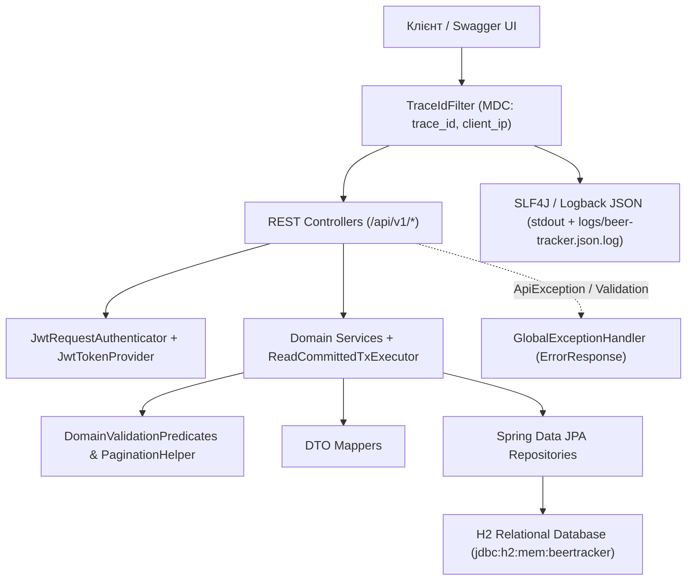

# Технічна архітектура та супровід системи (Architecture & Maintenance Guide)

**Проєкт:** Beer Tracker Backend API (`com.beertracker`)  
**Версія контракту API:** `2.1.0` ([`api/openapi.yaml`](file:///D:/uni/4-year/ПІС/beer-tracker/api/openapi.yaml))  
**Технологічний стек:** Java 25, Spring Boot 3.4.5, Spring Data JPA (Hibernate), H2 In-Memory DB, Spring Security Crypto (`BCrypt`), SpringDoc OpenAPI 2.8.5, Logback + `logstash-logback-encoder` 8.0.

---

## 1. Загальний архітектурний стиль

Система реалізована як **модульний моноліт із багатошаровою архітектурою (Layered Architecture)** у підході **API-First**:
1. **Transport / REST Layer (`controller`)** — приймає HTTP/JSON-запити під `/api/v1/*`, перевіряє Bearer JWT через [`JwtRequestAuthenticator`](file:///D:/uni/4-year/ПІС/beer-tracker/src/main/java/com/beertracker/security/JwtRequestAuthenticator.java) та делегує виконання сервісам.
2. **Domain Service Layer (`service`)** — реалізує бізнес-правила, міжсутнісну валідацію, консенсусні пороги (`N=5`), координацію блокувань і ACID-транзакції через [`ReadCommittedTxExecutor`](file:///D:/uni/4-year/ПІС/beer-tracker/src/main/java/com/beertracker/service/ReadCommittedTxExecutor.java).
3. **Validation & Mapping Layer (`validation`, `mapper`)** — ізольовані предикати ([`DomainValidationPredicates`](file:///D:/uni/4-year/ПІС/beer-tracker/src/main/java/com/beertracker/validation/DomainValidationPredicates.java)), уніфікована пагінація ([`PaginationHelper`](file:///D:/uni/4-year/ПІС/beer-tracker/src/main/java/com/beertracker/validation/PaginationHelper.java)) та чисте перетворення між JPA-сутностями і незмінними `record`-DTO (`dto`).
4. **Persistence Layer (`repository`, `model`)** — інтерфейси `JpaRepository` та реляційні сутності (`@Entity`), збережені в H2.
5. **Cross-Cutting Infrastructure (`filter`, `exception`, `security`, `config`)** — наскрізне трасування MDC ([`TraceIdFilter`](file:///D:/uni/4-year/ПІС/beer-tracker/src/main/java/com/beertracker/filter/TraceIdFilter.java)), уніфікована обробка помилок ([`GlobalExceptionHandler`](file:///D:/uni/4-year/ПІС/beer-tracker/src/main/java/com/beertracker/exception/GlobalExceptionHandler.java)), криптографія та вбудований Swagger UI ([`OpenApiStaticConfig`](file:///D:/uni/4-year/ПІС/beer-tracker/src/main/java/com/beertracker/config/OpenApiStaticConfig.java)).

---

## 2. Мапа пакетів та ключових компонентів

| Пакет | Призначення | Ключові класи |
| :--- | :--- | :--- |
| `com.beertracker` | Точка входу Spring Boot | [`BeerTrackerApplication`](file:///D:/uni/4-year/ПІС/beer-tracker/src/main/java/com/beertracker/BeerTrackerApplication.java) |
| `com.beertracker.config` | Роздача `/openapi.yaml` та редіректи Swagger UI | [`OpenApiStaticConfig`](file:///D:/uni/4-year/ПІС/beer-tracker/src/main/java/com/beertracker/config/OpenApiStaticConfig.java) |
| `com.beertracker.controller` | 9 REST-контролерів (28 операцій OpenAPI) | [`AuthController`](file:///D:/uni/4-year/ПІС/beer-tracker/src/main/java/com/beertracker/controller/AuthController.java), [`BeerController`](file:///D:/uni/4-year/ПІС/beer-tracker/src/main/java/com/beertracker/controller/BeerController.java), [`BeerVersionController`](file:///D:/uni/4-year/ПІС/beer-tracker/src/main/java/com/beertracker/controller/BeerVersionController.java), [`ConsumptionController`](file:///D:/uni/4-year/ПІС/beer-tracker/src/main/java/com/beertracker/controller/ConsumptionController.java), [`ReviewController`](file:///D:/uni/4-year/ПІС/beer-tracker/src/main/java/com/beertracker/controller/ReviewController.java), [`WishlistController`](file:///D:/uni/4-year/ПІС/beer-tracker/src/main/java/com/beertracker/controller/WishlistController.java), [`CollectionController`](file:///D:/uni/4-year/ПІС/beer-tracker/src/main/java/com/beertracker/controller/CollectionController.java), [`AnalyticsController`](file:///D:/uni/4-year/ПІС/beer-tracker/src/main/java/com/beertracker/controller/AnalyticsController.java), [`AdminController`](file:///D:/uni/4-year/ПІС/beer-tracker/src/main/java/com/beertracker/controller/AdminController.java) |
| `com.beertracker.service` | Бізнес-логіка, аналітика, транзакційна координація | [`AuthService`](file:///D:/uni/4-year/ПІС/beer-tracker/src/main/java/com/beertracker/service/AuthService.java), [`BeerService`](file:///D:/uni/4-year/ПІС/beer-tracker/src/main/java/com/beertracker/service/BeerService.java), [`BeerVersionService`](file:///D:/uni/4-year/ПІС/beer-tracker/src/main/java/com/beertracker/service/BeerVersionService.java), [`ConsumptionService`](file:///D:/uni/4-year/ПІС/beer-tracker/src/main/java/com/beertracker/service/ConsumptionService.java), [`ReviewService`](file:///D:/uni/4-year/ПІС/beer-tracker/src/main/java/com/beertracker/service/ReviewService.java), [`WishlistService`](file:///D:/uni/4-year/ПІС/beer-tracker/src/main/java/com/beertracker/service/WishlistService.java), [`CollectionService`](file:///D:/uni/4-year/ПІС/beer-tracker/src/main/java/com/beertracker/service/CollectionService.java), [`AnalyticsService`](file:///D:/uni/4-year/ПІС/beer-tracker/src/main/java/com/beertracker/service/AnalyticsService.java), [`StreakCalculator`](file:///D:/uni/4-year/ПІС/beer-tracker/src/main/java/com/beertracker/service/StreakCalculator.java), [`MergeService`](file:///D:/uni/4-year/ПІС/beer-tracker/src/main/java/com/beertracker/service/MergeService.java), [`ModerationService`](file:///D:/uni/4-year/ПІС/beer-tracker/src/main/java/com/beertracker/service/ModerationService.java), [`ReadCommittedTxExecutor`](file:///D:/uni/4-year/ПІС/beer-tracker/src/main/java/com/beertracker/service/ReadCommittedTxExecutor.java) |
| `com.beertracker.model` | 9 JPA-сутностей і JSON-конвертер версій | [`Beer`](file:///D:/uni/4-year/ПІС/beer-tracker/src/main/java/com/beertracker/model/Beer.java), [`BeerPackaging`](file:///D:/uni/4-year/ПІС/beer-tracker/src/main/java/com/beertracker/model/BeerPackaging.java), [`BeerVersion`](file:///D:/uni/4-year/ПІС/beer-tracker/src/main/java/com/beertracker/model/BeerVersion.java), [`BeerVersionPayloadConverter`](file:///D:/uni/4-year/ПІС/beer-tracker/src/main/java/com/beertracker/model/BeerVersionPayloadConverter.java), [`VersionVote`](file:///D:/uni/4-year/ПІС/beer-tracker/src/main/java/com/beertracker/model/VersionVote.java), [`ConsumptionEntry`](file:///D:/uni/4-year/ПІС/beer-tracker/src/main/java/com/beertracker/model/ConsumptionEntry.java), [`Review`](file:///D:/uni/4-year/ПІС/beer-tracker/src/main/java/com/beertracker/model/Review.java), [`WishlistItem`](file:///D:/uni/4-year/ПІС/beer-tracker/src/main/java/com/beertracker/model/WishlistItem.java), [`User`](file:///D:/uni/4-year/ПІС/beer-tracker/src/main/java/com/beertracker/model/User.java), [`RefreshToken`](file:///D:/uni/4-year/ПІС/beer-tracker/src/main/java/com/beertracker/model/RefreshToken.java) |
| `com.beertracker.repository` | 8 Spring Data JPA-репозиторіїв + очищувач старту | [`BeerRepository`](file:///D:/uni/4-year/ПІС/beer-tracker/src/main/java/com/beertracker/repository/BeerRepository.java), [`BeerVersionRepository`](file:///D:/uni/4-year/ПІС/beer-tracker/src/main/java/com/beertracker/repository/BeerVersionRepository.java), [`VersionVoteRepository`](file:///D:/uni/4-year/ПІС/beer-tracker/src/main/java/com/beertracker/repository/VersionVoteRepository.java), [`ConsumptionRepository`](file:///D:/uni/4-year/ПІС/beer-tracker/src/main/java/com/beertracker/repository/ConsumptionRepository.java), [`ReviewRepository`](file:///D:/uni/4-year/ПІС/beer-tracker/src/main/java/com/beertracker/repository/ReviewRepository.java), [`WishlistRepository`](file:///D:/uni/4-year/ПІС/beer-tracker/src/main/java/com/beertracker/repository/WishlistRepository.java), [`UserRepository`](file:///D:/uni/4-year/ПІС/beer-tracker/src/main/java/com/beertracker/repository/UserRepository.java), [`RefreshTokenRepository`](file:///D:/uni/4-year/ПІС/beer-tracker/src/main/java/com/beertracker/repository/RefreshTokenRepository.java), [`DatabaseStateInitializer`](file:///D:/uni/4-year/ПІС/beer-tracker/src/main/java/com/beertracker/repository/DatabaseStateInitializer.java) |
| `com.beertracker.dto` | 35 незмінних Java `record`-DTO (ізольованих від ORM) | Запити/відповіді згідно з `components/schemas` у [`openapi.yaml`](file:///D:/uni/4-year/ПІС/beer-tracker/api/openapi.yaml) |
| `com.beertracker.mapper` | Мапери сутностей у DTO та злиття чернеток версій | [`BeerMapper`](file:///D:/uni/4-year/ПІС/beer-tracker/src/main/java/com/beertracker/mapper/BeerMapper.java), [`BeerVersionMapper`](file:///D:/uni/4-year/ПІС/beer-tracker/src/main/java/com/beertracker/mapper/BeerVersionMapper.java), [`ConsumptionMapper`](file:///D:/uni/4-year/ПІС/beer-tracker/src/main/java/com/beertracker/mapper/ConsumptionMapper.java), [`ReviewMapper`](file:///D:/uni/4-year/ПІС/beer-tracker/src/main/java/com/beertracker/mapper/ReviewMapper.java), [`UserMapper`](file:///D:/uni/4-year/ПІС/beer-tracker/src/main/java/com/beertracker/mapper/UserMapper.java), [`WishlistMapper`](file:///D:/uni/4-year/ПІС/beer-tracker/src/main/java/com/beertracker/mapper/WishlistMapper.java) |
| `com.beertracker.security` | HS256 JWT, BCrypt(12), аутентифікація заголовка | [`JwtTokenProvider`](file:///D:/uni/4-year/ПІС/beer-tracker/src/main/java/com/beertracker/security/JwtTokenProvider.java), [`JwtRequestAuthenticator`](file:///D:/uni/4-year/ПІС/beer-tracker/src/main/java/com/beertracker/security/JwtRequestAuthenticator.java), [`SecurityConfig`](file:///D:/uni/4-year/ПІС/beer-tracker/src/main/java/com/beertracker/security/SecurityConfig.java) |
| `com.beertracker.validation` | Предикати доменних правил і утиліта пагінації | [`DomainValidationPredicates`](file:///D:/uni/4-year/ПІС/beer-tracker/src/main/java/com/beertracker/validation/DomainValidationPredicates.java), [`PaginationHelper`](file:///D:/uni/4-year/ПІС/beer-tracker/src/main/java/com/beertracker/validation/PaginationHelper.java) |
| `com.beertracker.exception` | Доменний виняток та глобальний обробник помилок | [`ApiException`](file:///D:/uni/4-year/ПІС/beer-tracker/src/main/java/com/beertracker/exception/ApiException.java), [`GlobalExceptionHandler`](file:///D:/uni/4-year/ПІС/beer-tracker/src/main/java/com/beertracker/exception/GlobalExceptionHandler.java) |
| `com.beertracker.filter` | Ініціалізація MDC (`trace_id`, `client_ip`, `user_id`) | [`TraceIdFilter`](file:///D:/uni/4-year/ПІС/beer-tracker/src/main/java/com/beertracker/filter/TraceIdFilter.java) |

---

## 3. Ключові архітектурні рішення та інваріанти для супроводу

### 3.1. ACID-транзакції та захист від гонок даних (`REQ-NF-007`, `REQ-NF-009`)
- Критичні багатокрокові операції (`ConsumptionService.recordConsumption`, `MergeService.mergeBeers`, `BeerVersionService.createBeerVersion`, `BeerVersionService.vote`, `ModerationService.*`, `ReviewService.*`, `WishlistService.*`) поєднують per-resource JVM-блокування (`synchronized`) із програмною транзакцією [`ReadCommittedTxExecutor`](file:///D:/uni/4-year/ПІС/beer-tracker/src/main/java/com/beertracker/service/ReadCommittedTxExecutor.java) (`ISOLATION_READ_COMMITTED`).
- Такий порядок гарантує, що **коміт БД відбувається строго до звільнення монітора блокування** (на відміну від проксованого `@Transactional` поверх `synchronized`-методу, де наступний потік міг би прочитати незакомічені лічильники `confirm_votes`).
- На рівні таблиці `version_votes` додатково встановлено унікальний індекс `(user_id, version_id)` у [`VersionVote`](file:///D:/uni/4-year/ПІС/beer-tracker/src/main/java/com/beertracker/model/VersionVote.java).

### 3.2. Незмінність журналу споживання та ізоляція даних (`REQ-F-007`, `REQ-NF-005`)
- [`ConsumptionController`](file:///D:/uni/4-year/ПІС/beer-tracker/src/main/java/com/beertracker/controller/ConsumptionController.java) явно перехоплює `PUT`, `PATCH`, `DELETE` на `/api/v1/consumption-entries/{id}` і повертає `405 Method Not Allowed` (`METHOD_NOT_ALLOWED`) із записом аудиту `security_violation_audit`.
- Операції читання та запису `ConsumptionEntry`, `WishlistItem`, `Collection` і `Analytics` вимагають Bearer JWT та фільтруються строго за `userId`; звернення до чужого `consumption-entries/{id}` повертає `404 Not Found` (`CONSUMPTION_ENTRY_NOT_FOUND`), запобігаючи перебору ID.

### 3.3. Безпека та автентифікація (`REQ-NF-004`, `REQ-NF-006`)
- Паролі хешуються через `BCryptPasswordEncoder(12)` у [`SecurityConfig`](file:///D:/uni/4-year/ПІС/beer-tracker/src/main/java/com/beertracker/security/SecurityConfig.java).
- Access-токени підписуються алгоритмом `HmacSHA256` (TTL `900` с) у [`JwtTokenProvider`](file:///D:/uni/4-year/ПІС/beer-tracker/src/main/java/com/beertracker/security/JwtTokenProvider.java); секрет конфігурується властивістю `security.jwt.secret`.
- Refresh-токени є одноразовими UUID (`30` діб), що атомарно переводяться у `revoked = true` через [`RefreshTokenRepository.consumeIfActive`](file:///D:/uni/4-year/ПІС/beer-tracker/src/main/java/com/beertracker/repository/RefreshTokenRepository.java).
- Модераторські дії перевіряють наявність claim `role = "MODERATOR"` через `JwtRequestAuthenticator.requireModeratorId`.

### 3.4. Трасування та структуроване JSON-логування (`REQ-NF-010`, `REQ-NF-011`)
- [`TraceIdFilter`](file:///D:/uni/4-year/ПІС/beer-tracker/src/main/java/com/beertracker/filter/TraceIdFilter.java) приймає або генерує заголовок `X-Trace-Id` і прокидає `trace_id`, `client_ip`, `user_id` та `status` у SLF4J MDC.
- [`logback-spring.xml`](file:///D:/uni/4-year/ПІС/beer-tracker/src/main/resources/logback-spring.xml) записує NDJSON через `LogstashEncoder` одночасно в консоль (`CONSOLE`) та ротований файл `logs/beer-tracker.json.log` (поріг 100 МБ, історія 30 діб, ліміт 10 ГБ).

---

## 4. Зафіксовані відхилення від початкової редакції SRS

| Тема | Початковий опис у [`spec/SRS.md`](file:///D:/uni/4-year/ПІС/beer-tracker/spec/SRS.md) | Фактична реалізація в коді |
| :--- | :--- | :--- |
| **СКБД і міграції** | PostgreSQL 16 + Testcontainers + Liquibase/Flyway + DB-тригери `no_update_consumption` | Реляційна H2 In-Memory (`jdbc:h2:mem:beertracker`) зі Spring Data JPA (`hibernate.ddl-auto=update`); заборона мутацій споживання забезпечується на рівні REST-контролера та сервісу; [`DatabaseStateInitializer`](file:///D:/uni/4-year/ПІС/beer-tracker/src/main/java/com/beertracker/repository/DatabaseStateInitializer.java) очищує таблиці при старті. |
| **Зберігання медіа** | Окреме об'єктне сховище S3 / Blob Storage | Клієнт передає зовнішній URI у полі `image_url`; серверне сховище файлів не розгорнуто. |
| **Відхилена версія-оновлення (`AC-005.2`)** | Фізичне видалення версії-оновлення при 5 голосах `REJECT` | Версія-оновлення зберігається в історії зі статусом `REJECTED`, а активна версія `Beer` залишається незмінною (підтверджено тестом у [`BeerVersionVotingIntegrationTest`](file:///D:/uni/4-year/ПІС/beer-tracker/src/test/java/com/beertracker/BeerVersionVotingIntegrationTest.java)). |
| **Структура тестів (§5.2)** | Окремі пакети `unit/`, `integration/`, `acceptance/` + Testcontainers | Інтеграційні `MockMvc` тести у `src/test/java/com/beertracker/*IntegrationTest.java` на H2 + Spring Boot Test. |
| **Навантажувальні тести (`REQ-NF-001..003`)** | 100 RPS (каталог), 30 RPS / 10k записів (аналітика), 50 Write RPS | **Навантаження не перевірялося** — у проєкті наявні лише функціональні та конкурентні інтеграційні тести (без JMeter/Gatling/load-тестів). |
