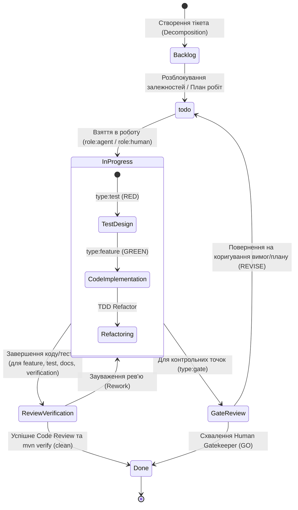
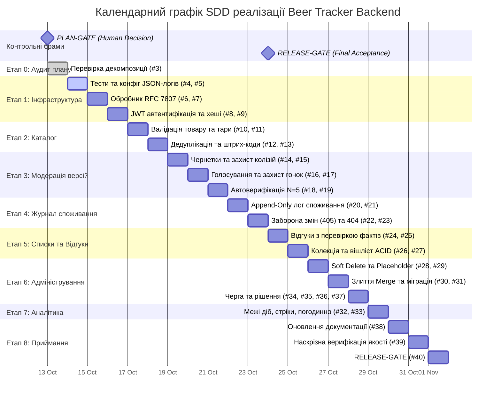

# План реалізації та календарний графік (Implementation Plan & Schedule)

## Проєкт: Beer Tracker Backend API
**Методологія:** Specification-Driven Development (SDD) & Test-Driven Development (TDD)  
**Ревізія специфікації:** SRS v2.1.0  
**Статус:** На розгляді PLAN-GATE  

---

## 1. Загальна структура робочого процесу (Workflow & GitHub Project Board)

Проєкт використовує трекер **GitHub Issues** та дошку **GitHub Projects** із моделлю життєвого циклу задачі (Status Workflow), що складається з 6 стандартизованих колонок:

### Колонки дошки проєкту (Project Board Columns):

1. **`Backlog`:**
   - **Призначення:** Черга зареєстрованих задач, які наразі заблоковані іншими тікетами (залежності `Blocked by`) або очікують проходження попередніх фаз.
   - **Правило переходу:** Задачі залишаються тут до повного виконання попередніх залежностей.

2. **`todo`:**
   - **Призначення:** Задачі, готові до взяття в роботу. Усі передуючі блокування знято, виконавець визначений.
   - **Правило переходу:** Переміщуються з `Backlog`, коли всі блокуючі тікети переходять у статус `Done`.

3. **`In Progress`:**
   - **Призначення:** Активна стадія безпосереднього виконання задачі.
   - **Для `type:test` (`role:agent`):** Розробка модульних, інтеграційних або BDD тестів за контрактом SRS; запуск через Maven та фіксація стану RED.
   - **Для `type:feature` (`role:agent`):** Написання мінімально необхідного виробничого коду за принципом TDD до переходу тестів у стан GREEN; рефакторинг.
   - **Для `type:documentation` (`role:agent`):** Оновлення матриці простежуваності та проєктної документації.

4. **`Review/Verification`:**
   - **Призначення:** Перевірка якості, архітектурної відповідності та контрактних інваріантів перед завершенням інженерних задач.
   - **Виконавці:** Спільна робота `role:hybrid` (агент + людина).
   - **Дії:** Проведення Code Review, валідація відсутності регресій (`mvn clean verify`), перевірка структурованих JSON-логів проти схем SRS. При виявленні зауважень тікет повертається в `In Progress`.

5. **`Gate Review`:**
   - **Призначення:** Спеціалізована колонка контрольних точок допуску (`type:gate`: PLAN-GATE, RELEASE-GATE).
   - **Виконавці:** Виключно `role:human` (Human Gatekeeper / Студент / Архітектор). Агенту суворо заборонено самостійно приймати рішення або закривати задачі в цій колонці.
   - **Дії:** Перевірка чек-листів аудиту, заповнення протоколів у `logs/*-gate-decision.md`, формальне винесення вердикту GO або REVISE.

6. **`Done`:**
   - **Призначення:** Повністю завершена та верифікована одиниця робіт.
   - **Критерій входу:**
     - Для інженерних тікетів (`test`/`feature`): 100% тестів успішні (GREEN), відсутність зауважень на Code Review, тікет закрито як Completed.
     - Для Gate: підписаний протокол рішення GO, тікет закрито інженером вручну.

---

## 2. Етапи реалізації та оцінка трудовитрат (Phased Breakdown)

Оцінки часу наведено з чітким розділенням на:
- **Час агента ($T_{agent}$):** Автоматична кодогенерація, запуск тестів через CLI, рефакторинг.
- **Час людини ($T_{human}$):** Архітектурний нагляд, валідація контракту, верифікація бізнес-правил, прийняття рішень на Gate.

| Етап / Фаза | Складові задачі (Issues) | Опис та цілі етапу | $T_{agent}$ (год) | $T_{human}$ (год) | Загальний час (год) |
| :--- | :--- | :--- | :---: | :---: | :---: |
| **Етап 0: Аудит та PLAN-GATE** | #3 | Затвердження декомпозиції, TDD-залежностей та реєстру ризиків | 0.5 | 2.0 | 2.5 |
| **Етап 1: Інфраструктура та Безпека** | #4, #5, #6, #7, #8, #9 | Структуроване логування (Logback/MDC), обробник помилок RFC 7807, JWT-автентифікація | 2.5 | 1.5 | 4.0 |
| **Етап 2: Ядро каталогу та Дедуплікація** | #10, #11, #12, #13 | Доменні моделі `Beer`/`Packaging`, валідація тари [50..10k] мл, нормалізація назв, унікальність штрих-кодів | 2.5 | 1.0 | 3.5 |
| **Етап 3: Вікі-версіонування та Крауд-модерація** | #14, #15, #16, #17, #18, #19 | Чернетки `BeerVersion`, захист від колізій, паралельне голосування, автоматичні пороги N=5 | 3.5 | 1.5 | 5.0 |
| **Етап 4: Журнал споживання (Append-Only)** | #20, #21, #22, #23 | Фіксація споживання, строга заборона PUT/PATCH/DELETE (405), часові рамки, ізоляція доступу (404) | 2.5 | 1.5 | 4.0 |
| **Етап 5: Відгуки, Колекція та Wishlist** | #24, #25, #26, #27 | Перевірка фактів споживання перед публікацією відгуку, транзакційне автоочищення Wishlist | 2.0 | 1.0 | 3.0 |
| **Етап 6: Адміністрування (Merge & Soft Delete)** | #28, #29, #30, #31, #34, #35, #36, #37 | М'яке видалення (Placeholder Beer), злиття дублікатів (міграція FKs та пакувань), черга модерації | 3.5 | 2.0 | 5.5 |
| **Етап 7: Аналітика, Доба [00:00, 24:00) та Стріки** | #32, #33 | Обчислення календаря в часовому поясі IANA, Current/Longest streaks, погодинний профіль споживання | 2.5 | 1.0 | 3.5 |
| **Етап 8: Комплексна верифікація та RELEASE-GATE** | #38, #39, #40 | Оновлення матриці простежуваності, `mvn verify`, перевірка логів, фінальний аудит Human Gatekeeper | 1.5 | 2.5 | 4.0 |
| **РАЗОМ** | **38 задач (#3..#40)** | **Повний виробничий цикл системи** | **21.0** | **14.0** | **35.0** |

---

## 3. Діаграма Ганта (Gantt Chart)

---

## 4. Аналіз критичного шляху (Critical Path Analysis)

Критичний шлях визначає послідовність задач із нульовим резервом часу, затримка будь-якої з яких безпосередньо відтерміновує фінальний реліз системи:

$$\text{Critical Path} = \mathbf{PLAN\text{-}GATE} \rightarrow \mathbf{Infra/Auth} \rightarrow \mathbf{Catalog} \rightarrow \mathbf{Consumption} \rightarrow \mathbf{Reviews/Lists} \rightarrow \mathbf{Merge} \rightarrow \mathbf{Verification} \rightarrow \mathbf{RELEASE\text{-}GATE}$$

### Ланцюжок критичного шляху:
1. **#3 [GATE] PLAN-GATE:** Без формального схвалення неможливий запуск генерації коду.
2. **#8 & #9 (JWT Authentication & Security):** Необхідна для отримання ідентифікатора користувача `user_id` у контексті безпеки.
3. **#10 & #11 (Beer Catalog & Packaging):** Базові сутності каталогу є обов'язковими зовнішніми ключами для журналів споживання.
4. **#20 & #21 (ConsumptionEntry Append-Only):** Незмінний журнал споживання є основою для всіх похідних сутностей.
5. **#26 & #27 (Transactional Collection & Wishlist):** Логіка залежить від створення записів споживання.
6. **#30 & #31 (Merge Service):** Складна транзакційна операція, що переприв'язує пакування, записи споживання та відгуки.
7. **#39 (Verification Quality Gate):** Повний запуск тестового набору `mvn verify` та аудит структурованих логів.
8. **#40 [GATE] RELEASE-GATE:** Фінальний людський sign-off перед публікацією.

---

## 5. Врахування пропускної здатності людини (Human Bottleneck Management)

ШІ-агент виконує технічні операції кодування за лічені хвилини, проте загальний темп проєкту обмежується людським фактором:
1. **Рішення на Gate-контрольних точках:** Потребують вдумливого аналізу документації та артефактів (заплановано 2.0 год на PLAN-GATE та 2.5 год на RELEASE-GATE).
2. **Аудит критичних транзакцій (Merge, Append-Only):** Перевірка SQL-планів, наявності захисту від race conditions та рівнів ізоляції ACID вимагає кваліфікованого інженерного нагляду.
3. **Запобігання Automation Bias (сліпому схваленню):** Заборонено автоматичне закриття задач `role:hybrid` без особистого перегляду diff людиною.

---

## 6. Вимоги з підвищеною ціною відмови (High Cost of Failure)

Наступні вимоги несуть критичні ризики цілісності даних і потребують подвійного контролю (Double Verification):
1. **REQ-F-007 (Незмінність журналу споживання):** Помилка в API або відсутність DB-тригера може призвести до зміни історії споживання. Необхідно заблокувати методи на рівні фільтрів Spring та тригерів СУБД.
2. **REQ-F-011 / REQ-NF-007 (Транзакційне злиття Merge):** Неповне оновлення зовнішніх ключів або втрата пакувань зруйнує реляційну цілісність. Обов'язкове покриття тестами з імітацією помилок для перевірки Rollback.
3. **REQ-F-004 / REQ-NF-009 (Паралельне голосування):** Ризик гонки даних при голосуванні кількох користувачів. Вимагає обов'язкового багатопотокового стрес-тестування `VersionVotingConcurrencyIT`.
