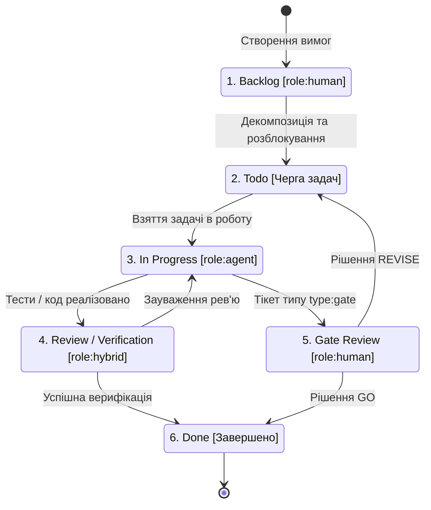

# Діаграма життєвого циклу задачі (Task Lifecycle Diagram)

## Проєкт: Beer Tracker Backend API
**Модель життєвого циклу:** SDD / TDD із розподілом ролей (Human-in-the-Loop)  
**Колонки дошки:** `Backlog` $\rightarrow$ `todo` $\rightarrow$ `In Progress` $\rightarrow$ `Review/Verification` / `Gate Review` $\rightarrow$ `Done`  

---

### Діаграма переходів станів (State Diagram)

---

### Відповідальність ролей за станами

| Стан / Колонка | Відповідальна роль | Дія ролі |
| :--- | :---: | :--- |
| **`Backlog`** | `role:human` | Формування та затвердження вимог SRS, пріоритизація. |
| **`Todo`** | Автоматично / Черга | Перехід після зняття залежностей (`Blocked by`). |
| **`In Progress`** | `role:agent` | Написання тестів у фазі RED, реалізація коду в GREEN. |
| **`Review/Verification`** | `role:hybrid` | Спільне Code Review: агент перевіряє схеми/тести, людина затверджує. |
| **`Gate Review`** | `role:human` | Прийняття критичних рішень на контрольних точках (PLAN-GATE, RELEASE-GATE). |
| **`Done`** | Усі ролі | Фіксація результату, закриття тікета як Completed. |
