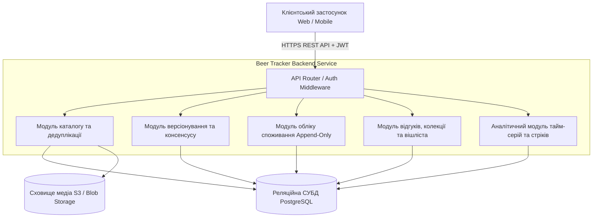
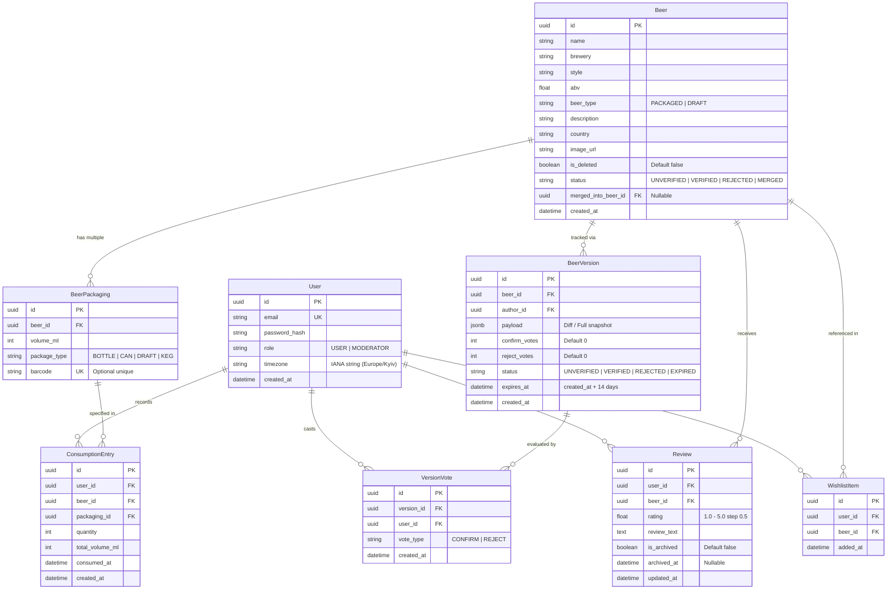
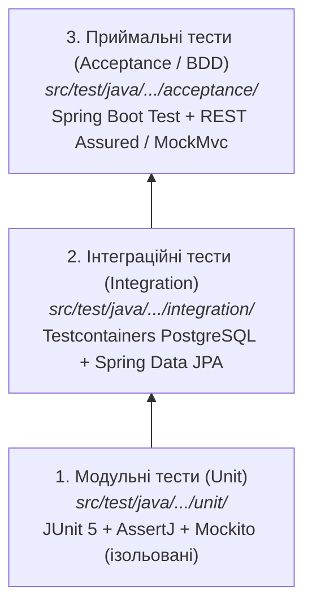

# Специфікація вимог до програмного забезпечення (SRS)
## Система обліку споживання пива та персонального каталогу (Beer Tracker Backend)
**Стандарт:** IEEE Std 830-1998  
**Версія документа:** 2.1.0 (Post-Audit Revision: TDD & Mandatory Structured Logging)  
**Статус:** APPROVED  
**Дата випуску:** 2026-10-12  

---

## 1. Вступ (Introduction)

### 1.1. Призначення документа та системи
Цей документ містить повну специфікацію вимог до серверної частини (Backend API) системи "Beer Tracker". Специфікація встановлює формальні вимоги до функціональності, інтерфейсів, продуктивності, безпеки та надійності системи й слугує обов'язковим контрактом для проектування, розробки, автоматизованого тестування та приймання продукту. У межах інженерного процесу специфікація інтегрує методологію розробки через тестування (Test-Driven Development, TDD): у поєднанні з набором автоматизованих тестів цей документ становить суворий поведінковий контракт, обов'язковий для задоволення командою та AI-асистентами розробки.

Система "Beer Tracker" — це серверний застосунок, що поєднує можливості точного кількісного обліку вжитих напоїв (у формі незмінного журналу записів споживання `ConsumptionEntry`) та дегустаційного щоденника з персональною аналітикою та краудсорсинговим каталогом продукції на wiki-засадах.

### 1.2. Межі системи (Scope Boundaries)

#### 1.2.1. In-Scope (Гарантована функціональність поточної версії)
1. **Керування каталогом продукції (Wiki-модель):**
   - Реєстрація сортів пива з обов'язковими атрибутами: назва, виробник, стиль, міцність (ABV), тип продукту (`beer_type: PACKAGED | DRAFT`) та перелік доступних варіантів тари;
   - Відокремлений облік розливного пива (`Draft Beer`) як самостійного товару каталогу з валідацією типу тари;
   - Підтримка множинних пакувань (`Packaging`: об'єм у мл, тип тари, асоційовані унікальні штрих-коди);
   - Автодоповнення та вибір із бази вже існуючих виробників та стилів;
   - Превентивна дедуплікація за штрих-кодом або нормалізованою парою `(brewery + name)` зі статусом `409 Conflict`.
2. **Вікі-версіонування та консенсусна крауд-модерація:**
   - Реєстрація пропозицій змін до існуючих товарів через чернетки версій (`BeerVersion`);
   - Захист від розгалужень (Forks): наявність строго однієї активної чернетки версії у статусі `UNVERIFIED` для одного товару;
   - Краудсорсингове голосування користувачів із двома незалежними інкрементальними лічильниками `confirm_votes` та `reject_votes` із фіксованим порогом $N=5$;
   - Заборона автоголосування (автор версії не може голосувати за власну пропозицію);
   - Автоматична верифікація версії з деактивацією застарілої;
   - Автоматичне відхилення версій: видалення відхилених правок до існуючих товарів та маркування нових непідтверджених товарів статусом `REJECTED`;
   - Захист від зависання версій (Deadlock/Starvation): строк дії чернетки (TTL) становить 14 календарних днів;
   - Адміністративна черга модерації для обробки відхилених продуктів та примусової верифікації модератором.
8. **Обов'язкове структуроване JSON-логування та аудит:**
   - Наскрізне логування ключових бізнес-операцій та помилок у машиночитному форматі JSON (консоль та ротаційні файли);
   - Кореляція запитів через контекст трасування MDC (`trace_id`, `user_id`, `client_ip`);
   - Стабільні уніфіковані JSON-схеми для подій пошуку, обліку споживання, голосування за версії, злиття (Merge) та аудиту безпеки.
9. **Інженерна дисципліна Test-Driven Development (TDD):**
   - Розробка за принципом "Test First": тест пишеться до написання коду реалізації за ітеративним циклом Red-Green-Refactor;
   - Тришарова піраміда тестування: модульні (Unit), інтеграційні (Integration на базі Testcontainers PostgreSQL), приймальні (Acceptance / BDD);
   - Забезпечення обов'язкового тестового покриття всіх контрактних пунктів специфікації та BDD-сценаріїв як quality gate.
3. **Кількісний облік споживання (Append-Only Log):**
   - Фіксація фактів вживання (`ConsumptionEntry`) із прив'язкою до тари, кількості одиниць та мітки часу;
   - Автоматичний розрахунок сумарного об'єму в мілілітрах ($ml$);
   - Валідація допустимих часових меж споживання (від моменту реєстрації користувача та не старіше 1 року до поточного часу);
   - Абсолютна незмінність журналу споживання: повна заборона методів `PUT`, `PATCH`, `DELETE` на рівні API та СУБД;
   - Сувора конфіденційність та ізоляція логів між користувачами (повернення `404 Not Found` при спробі несанкціонованого доступу).
4. **Рейтинги, відгуки, дегустаційна колекція та Wishlist:**
   - Публікація оцінки (1.0–5.0 з кроком 0.5) та відгуку (`Review`) строго після фіксації факту споживання продукту;
   - Правило єдиного активного відгуку на продукт від одного користувача з можливістю подальшого редагування;
   - Автоматичне формування персональної колекції (`Collection`) на основі фактів споживання;
   - Ведення списку бажань (`Wishlist`) із детермінованим автоматичним видаленням товару при першому вживанні.
5. **Адміністративне обслуговування та збереження цілісності:**
   - М'яке видалення (Soft Delete) продуктів із підстановкою сутності-заглушки (`Placeholder Beer`), що зберігає історичний літраж користувача;
   - Злиття дублікатів (`Merge`) із коректним мапінгом та міграцією пакувань, переприв'язкою зовнішніх ключів записів споживання та архівацією старіших дублікатів відгуків (`is_archived = true`).
6. **Аналітичний часовий модуль:**
   - Розрахунок аналітики в розрізі збереженого IANA-часового поясу користувача;
   - Детермінована межа календарної доби (`Day Boundary`): напіввідкритий інтервал $[00:00:00.000, 24:00:00.000)$;
   - Обчислення поточного (`Current Streak`) та максимального (`Longest Streak`) стріків днів споживання;
   - Агрегації споживання за день, тиждень, місяць або довільний проміжок дат;
   - Добовий погодинний профіль споживання (0–23 години) із точними формулами середнього об'єму та кількості записів.
7. **Автентифікація та авторизація:**
   - Автентифікація на основі JWT (Access 15 хв / Refresh 30 днів із ротацією);
   - Рольова модель доступу (Guest, User, Moderator).

#### 1.2.2. Out-of-Scope (Свідомо виключено з поточної версії)
1. ❌ **Графічні інтерфейси:** Клієнтські застосунки (Web SPA, iOS, Android). Реалізується виключно headless REST API.
2. ❌ **Серверне розпізнавання образів (OCR / CV):** Автоматичне сканування етикеток чи штрих-кодів за фотографіями на бекенді. Клієнт передає готовий числовий рядок штрих-коду або URL завантаженого зображення.
3. ❌ **Зовнішні інтеграції:** Імпорт або синхронізація з Untappd, RateBeer, Open Food Facts. База ведеться автономно за принципом wiki.
4. ❌ **Токсикологічні розрахунки:** Розрахунок вмісту алкоголю в крові (BAC / проміле), часу протверезіння чи врахування фізіологічних параметрів користувача. Обчислюється лише фізичний об'єм напою ($ml$).
5. ❌ **Соціальні механіки:** Стрічка активності (feed), система друзів, обмін повідомленнями, коментування чужих відгуків, лайки.
6. ❌ **Комерційні функції та геодані:** Облік цін, сканування фіскальних чеків, геолокація закладів, картографічні сервіси, оплата.
7. ❌ **Редагування/видалення записів споживання:** Будь-які запити на зміну вже зафіксованої історії споживання відхиляються за дизайном системи.

---

### 1.3. Глосарій предметної області (Domain Glossary / Ubiquitous Language)

| Термін (Ubiquitous Language) | Офіційне визначення в системі | Дозволені синоніми | ❌ ЗАБОРОНЕНІ синоніми | Bounded Context |
| :--- | :--- | :--- | :--- | :--- |
| **`Beer`** | Канонічна сутність напою в каталозі: стабільний `id`, назва, броварня, стиль, ABV, тип товару (`beer_type`), перелік пакувань. | Напій, Продукт, Товар | `Drink`, `AlcoholItem`, `Good`, `Bottle` | **Catalog Context** |
| **`Draft Beer`** | Товар у каталозі з `beer_type = DRAFT`, призначений виключно для обліку розливного пива. | Розливне пиво | `Tap`, `OnTapItem` | **Catalog Context** |
| **`Packaging`** (`BeerPackaging`) | Варіант тари конкретного `Beer` із фіксованим об'ємом у мл, типом упаковки та опціональним штрих-кодом. | Тара, Варіант пакування | `SKU`, `Size`, `VolumeOption` | **Catalog Context** |
| **`BeerVersion`** | Пропозиція нової версії продукту `Beer`, створена користувачем, що очікує краудсорсингової або адміністративної верифікації. | Чернетка версії, Версія продукту | `Draft` *(щоб не плутати з Draft Beer)*, `Modification` | **Moderation Context** |
| **`ConsumptionEntry`** | Незмінний факт індивідуального споживання певної кількості одиниць конкретного `Packaging` у вказаний момент часу. | Лог споживання, Запис споживання, Факт споживання | `Order`, `DrinkEvent`, `IntakeLog`, `Transaction` *(слово Transaction зарезервоване лише для ACID)* | **Consumption Context** |
| **`Review`** | Оцінка (1.0–5.0) та текст вражень користувача на конкретний `Beer`. Може бути лише один активний на пару `(User, Beer)`. | Відгук, Оцінка | `Feedback`, `Comment`, `Impression` | **Review Context** |
| **`Wishlist`** (`WishlistItem`) | Персональний список сортів пива, які користувач має намір скуштувати в майбутньому. | Список бажань | `Favorites`, `Bookmarks`, `Cart`, `ToBuy` | **Personal Collection** |
| **`Collection`** (`Tasted Collection`) | Автоматично сформована віртуальна множина всіх унікальних `Beer`, щодо яких користувач має хоча б один запис споживання. | Дегустаційна колекція, Список скуштованого | `History`, `Cellar` | **Personal Collection** |
| **`VersionVote`** | Голос автентифікованого користувача (`CONFIRM` або `REJECT`) за запропоновану `BeerVersion`. | Голос верифікації | `Like`, `Dislike`, `RatingVote` | **Moderation Context** |
| **`Streak`** | Неперервна послідовність календарних діб (за таймзоною користувача), у кожній з яких зафіксовано $\ge 1$ запис споживання. | Серія днів споживання | `DayChain`, `ContinuousDays`, `Session` | **Analytics Context** |
| **`Day Boundary`** | Момент початку нової календарної доби за часовим поясом користувача — фіксується рівно о `00:00:00.000` місцевого часу. | Межа доби, Початок доби | `Midnight` *(як розмовне наближення)* | **Analytics Context** |
| **`Placeholder Beer`** | Системний стан продукту (`is_deleted = true`), що повертається замість видаленого товару для збереження цілісності історичних записів споживання. | Товар-заглушка, "Видалений продукт" | `NullBeer`, `DeletedItem`, `Ghost` | **Data Integrity** |
| **`Merge`** | Адміністративна операція об'єднання дубліката (`source_beer`) з канонічним товаром (`target_beer`) із міграцією пакувань та записів споживання. | Злиття товарів | `Combine`, `Join`, `Relink` | **Data Integrity** |

---

## 2. Загальний опис (Overall Description)

### 2.1. Перспектива продукту та контекст
Система "Beer Tracker" функціонує як незалежний бекенд-сервіс, доступний через протокол HTTPS. Архітектура спирається на REST API зі збереженням стану в реляційній СКБД та об'єктному сховищі для медіафайлів (фото етикеток).



### 2.2. Характеристики користувачів (Ролі та права)
У системі діє рольова модель доступу (RBAC):

| Дія / Ендпоінт | Гість (`Guest`) | Користувач (`User`) | Модератор (`Moderator`) |
| :--- | :---: | :---: | :---: |
| Реєстрація та автентифікація | ✅ | ✅ | ✅ |
| Перегляд каталогу та публічних відгуків | ✅ | ✅ | ✅ |
| Пошук та автодоповнення по каталогу | ✅ | ✅ | ✅ |
| Створення нового продукту (Unverified) | ❌ | ✅ | ✅ |
| Створення нової версії продукту (`BeerVersion`) | ❌ | ✅ | ✅ |
| Отримання чернеток версій для голосування | ❌ | ✅ | ✅ |
| Голосування за версію (CONFIRM / REJECT) | ❌ | ✅ *(крім власних)* | ✅ |
| Ручна верифікація версії модератором | ❌ | ❌ | ✅ |
| Ручне відхилення версії модератором | ❌ | ❌ | ✅ |
| Перегляд та опрацювання черги модерації | ❌ | ❌ | ✅ |
| Видалення продукту (Soft Delete / Placeholder) | ❌ | ❌ | ✅ |
| Злиття дублікатів (Merge) | ❌ | ❌ | ✅ |
| Фіксація споживання (Append-Only Log) | ❌ | ✅ *(тільки власні)* | ✅ *(тільки власні)* |
| Додавання / видалення з Wishlist | ❌ | ✅ *(тільки власний)* | ✅ *(тільки власний)* |
| Написання / зміна відгуку (після споживання) | ❌ | ✅ *(1 на сорт)* | ✅ *(1 на сорт)* |
| Перегляд персональної аналітики та стріків | ❌ | ✅ *(тільки власна)* | ✅ *(тільки власна)* |

### 2.3. Загальні обмеження
1. **Технологічні обмеження:**
   - Взаємодія здійснюється суворо через RESTful API у форматі JSON;
   - Канонічною одиницею вимірювання об'єму є мілілітри ($ml$, ціле число);
   - Часові мітки зберігаються в базі даних виключно в UTC (ISO 8601).
2. **Бізнес-обмеження:**
   - Незмінність записів споживання: записи журналу споживання захищені від модифікацій та видалень;
   - Конкурентні чернетки: для одного товару дозволена наявність щонайбільше однієї активної пропозиції змін у статусі `UNVERIFIED`;
   - Обчислення доби для аналітики прив'язане до часового поясу IANA користувача;
   - Крауд-модерація керується детермінованими лічильниками з порогом у 5 голосів ($N=5$) та строком дії чернетки 14 днів.
3. **Інженерні та методологічні обмеження:**
   - Формат логування: виключно структурований JSON зі стабільною схемою полів на базі SLF4J / Logback (`logstash-logback-encoder`);
   - Методологія розробки: обов'язкове дотримання Test-Driven Development (TDD) — заборонено впроваджувати код без попередньо створеного тесту, що падає;
   - Технологічний стек тестування: JUnit 5, AssertJ, Mockito, Testcontainers (PostgreSQL 16) та Maven (плагіни Surefire та Failsafe).

---

## 3. Специфічні вимоги (Specific Requirements)

### 3.1. Функціональні вимоги (Functional Requirements)

#### REQ-F-001: Реєстрація нового продукту в каталозі
Система повинна надавати автентифікованому користувачеві можливість зареєструвати новий сорт пива, вказавши назву, виробника, стиль, ABV, тип товару (`beer_type`), опціональний опис, країну, зображення та перелік варіантів пакування.
* **AC-001.1:** При успішному створенні продукту система призначає йому початковий статус `UNVERIFIED` та генерує унікальний стабільний `id`.
* **AC-001.2:** Якщо запит на створення не містить жодного варіанту пакування або хоча б одне пакування має об'єм $< 50$ мл чи $> 10000$ мл, система повертає код помилки `422 Unprocessable Entity`.
* **AC-001.3:** Якщо створено продукт із типом `beer_type = DRAFT`, усі асоційовані варіанти пакування повинні мати `package_type = DRAFT`. Спроба передати пакування `BOTTLE` або `CAN` для товару з типом `DRAFT` відхиляється з кодом `422 Unprocessable Entity`.
* **AC-001.4:** Якщо створено продукт із типом `beer_type = PACKAGED`, спроба передати пакування з `package_type = DRAFT` відхиляється з кодом `422 Unprocessable Entity`.

#### REQ-F-002: Превентивна дедуплікація каталогу
Система повинна перевіряти унікальність нового продукту перед збереженням.
* **AC-002.1:** Якщо в каталозі вже існує активний продукт із такою ж парою `(brewery, name)` (без урахування регістру літер та зайвих пробілів), система повертає статус `409 Conflict`.
* **AC-002.2:** Якщо будь-який зі штрих-кодів у варіантах пакування вже асоційований з іншим продуктом, система повертає `409 Conflict` із зазначенням конфліктного штрих-коду.

#### REQ-F-003: Створення нової версії продукту (`BeerVersion`)
Система повинна реєструвати всі пропозиції змін атрибутів існуючого товару (включно з додаванням нових пакувань) у формі окремої сутності `BeerVersion`.
* **AC-003.1:** При відправці запиту на створення нової версії система створює запис `BeerVersion` зі статусом `UNVERIFIED`, початковими лічильниками `confirm_votes = 0`, `reject_votes = 0` та міткою закінчення терміну дії `expires_at = now() + 14 days`.
* **AC-003.2:** Якщо для даного товару вже існує запис `BeerVersion` у статусі `UNVERIFIED`, спроба створити ще одну версію відхиляється зі статусом `409 Conflict` (захист від конкурентних чернеток).
* **AC-003.3:** Запити на отримання картки товару за замовчуванням повертають найновішу запропоновану версію; за наявності параметра `verified_only=true` повертається остання версія `VERIFIED`.

#### REQ-F-004: Краудсорсингове голосування за версію
Система повинна приймати голоси спільноти на підтримку (`CONFIRM`) або відхилення (`REJECT`) чернетки версії товару.
* **AC-004.1:** Автор запропонованої версії отримує відповідь `403 Forbidden` при спробі проголосувати за власну версію.
* **AC-004.2:** Повторне голосування користувача за ту саму версію повертає помилку `409 Conflict`.
* **AC-004.3:** Дозволеними значеннями типу голосу є суворо `CONFIRM` (+1 до лічильника `confirm_votes`) або `REJECT` (+1 до лічильника `reject_votes`). Зменшення лічильників чи скалярний баланс не допускаються.

#### REQ-F-005: Автоматична верифікація, відхилення та TTL версій
Система повинна автоматично змінювати стан версії при накопиченні 5 однакових голосів або після завершення терміну дії чернетки.
* **AC-005.1:** При досягненні 5 голосів `confirm_votes` версія переходить у статус `VERIFIED`. Якщо це оновлення існуючого товару, попередня верифікована версія деактивується.
* **AC-005.2:** Якщо запропонована версія-оновлення існуючого товару набирає 5 голосів `reject_votes`, вона видаляється з системи, а діюча верифікована версія залишається діяти.
* **AC-005.3:** Якщо абсолютно новий продукт набирає 5 голосів `reject_votes`, він переходить у статус `REJECTED` і виноситься в чергу модерації.
* **AC-005.4:** Якщо за 14 календарних днів (`expires_at <= now()`) версія не набрала 5 голосів жодного типу, вона автоматично позначається як `EXPIRED` та архівується.

#### REQ-F-006: Реєстрація факту споживання (Append-Only Log)
Система повинна фіксувати факт споживання напою користувачем із прив'язкою до тари та кількості одиниць.
* **AC-006.1:** Сервер автоматично вираховує та зберігає підсумковий об'єм у мілілітрах як добуток `quantity * Packaging.volume_ml`.
* **AC-006.2:** Якщо часова мітка `consumed_at` є пізнішою за поточний серверний час (`consumed_at > now()`), запис відхиляється з кодом `422 Unprocessable Entity`.
* **AC-006.3:** Якщо часова мітка `consumed_at` є ранішою за дату реєстрації облікового запису користувача (`consumed_at < User.created_at`) або старішою за 1 рік від поточної дати (`consumed_at < now() - 1 year`), запит відхиляється з кодом `422 Unprocessable Entity`.
* **AC-006.4:** При значеннях кількості `quantity < 1` або `quantity > 100` повертається код `422 Unprocessable Entity`.

#### REQ-F-007: Заборона зміни та видалення записів споживання
Система повинна забезпечувати незмінність журналу споживання.
* **AC-007.1:** При спробі виклику HTTP-методів `PUT`, `PATCH` або `DELETE` на ендпоінтах записів споживання (`/api/v1/consumption/*`) сервер повертає статус `405 Method Not Allowed`.
* **AC-007.2:** Жодна сервісна дія над каталогом не призводить до видалення записів споживання з бази даних.

#### REQ-F-008: Написання та оновлення дегустаційного відгуку
Система повинна дозволяти користувачеві залишити публічну оцінку та текст вражень виключно після споживання напою.
* **AC-008.1:** При спробі публікації відгуку без наявності хоча б одного запису споживання цього товару в користувача сервер повертає `403 Forbidden`.
* **AC-008.2:** Числова оцінка повинна знаходитися в межах від 1.0 до 5.0 із фіксованим кроком 0.5. Будь-які інші значення відхиляються з кодом `422 Unprocessable Entity`.
* **AC-008.3:** Користувач може мати не більше одного активного відгуку (`is_archived = false`) на конкретний товар; повторні звернення оновлюють існуючий відгук.

#### REQ-F-009: Автоматичне формування колекції та автоочищення Wishlist
Система повинна автоматично синхронізувати особисті списки користувача.
* **AC-009.1:** При фіксації першого запису споживання продукту цей сорт пива автоматично додається до списку `Collection` користувача.
* **AC-009.2:** Якщо даний напій перебував у списку `Wishlist` користувача, він автоматично та безповоротно видаляється з `Wishlist` у межах тієї ж самої системної транзакції БД.

#### REQ-F-010: Видалення продукту модератором та Placeholder
Система повинна підтримувати безпечне вилучення товару модератором.
* **AC-010.1:** При видаленні товару модератором фізичний запис у базі не знищується: товар позначається як `is_deleted = true` і вилучається з пошуку каталогу та вішлістів.
* **AC-010.2:** В історії споживання користувачів видалений напій відображається під системною назвою "Видалений продукт" (`Placeholder Beer`) зі збереженням історичного об'єму та дати.

#### REQ-F-011: Злиття дублікатів (Merge)
Система повинна дозволяти модератору об'єднати два товари-дублікати із забезпеченням реляційної цілісності та міграцією пакувань.
* **AC-011.1:** Для кожного пакування з `source_beer_id` система виконує пошук еквівалентного пакування в `target_beer_id` за збігом `(volume_ml, package_type)`. Якщо відповідного пакування немає, воно автоматично створюється в `target_beer_id`.
* **AC-011.2:** Усі записи споживання `ConsumptionEntry`, що посилалися на `source_beer_id` та його пакування, атомарно оновлюють зовнішні ключі: `beer_id = target_beer_id` та `packaging_id = target_packaging_id`.
* **AC-011.3:** Якщо користувач мав відгуки на обидва товари, старіший відгук (за датою `updated_at`) отримує статус `is_archived = true` та вилучається з публічного розрахунку рейтингу, а новіший відгук залишається активним для `target_beer_id`.
* **AC-011.4:** Товар-дублікат `source_beer_id` позначається статусом `status = MERGED`, прапорцем `is_deleted = true` та встановлює зовнішній ключ `merged_into_beer_id = target_beer_id`.

#### REQ-F-012: Розрахунок аналітики споживання та стріків
Система повинна агрегувати показники споживання з детермінованим урахуванням часового поясу користувача.
* **AC-012.1:** Межа зміни доби визначається за зареєстрованим IANA-поясом користувача: доба розраховується як напіввідкритий інтервал $[00:00:00.000, 24:00:00.000)$. Будь-який запис, зафіксований від `00:00:00.000` включно, належить новому календарному дню (`Day Boundary`).
* **AC-012.2:** `Current Streak` обчислюється як неперервна кількість послідовних календарних днів споживання, що завершується сьогоднішньою або вчорашньою датою користувача.
* **AC-012.3:** Погодинний профіль споживання за дату повертає фактичний об'єм (мл) та кількість записів для кожногодинного слота $h \in [0..23]$.
* **AC-012.4:** Середній історичний профіль споживання для кожногодинного слота $h \in [0..23]$ обчислюється як:
  $$\text{average\_volume\_ml}[h] = \frac{\sum \text{volume\_ml}[h]}{\text{total\_active\_days}}, \quad \text{entry\_count}[h] = \sum \text{entries}[h]$$
  де $\text{total\_active\_days}$ — кількість унікальних календарних днів, у які користувач робив щонайменше один запис споживання.

#### REQ-F-013: Адміністративна верифікація та відхилення версій модератором
Система повинна надавати модератору повноваження щодо миттєвого затвердження або відхилення будь-якої чернетки версії товару в обхід краудсорсингового голосування.
* **AC-013.1:** При виклику ендпоінту верифікації модератором версія `BeerVersion` негайно отримує статус `VERIFIED`, стає діючою базою каталогу, а попередня версія деактивується.
* **AC-013.2:** При виклику ендпоінту відхилення модератором версія отримує статус `REJECTED` та деактивується.
* **AC-013.3:** Виклики цих операцій неавтентифікованими користувачами або звичайними користувачами відхиляються зі статусом `403 Forbidden`.

#### REQ-F-014: Опрацювання черги модерації відхилених продуктів
Система повинна вести окрему чергу модерації для нових сортів пива, які були відхилені краудсорсингом ($N=5$ Reject) або потребують ручного аудиту.
* **AC-014.1:** Система надає модераторам ендпоінт перегляду товарів у статусі `REJECTED`.
* **AC-014.2:** Модератор має можливість виконати рішення: схвалити товар (`APPROVE`, переведення в `VERIFIED`) або безповоротно видалити з черги (`PERMANENT_DELETE`).

---

### 3.2. Вимоги до зовнішніх інтерфейсів (External Interfaces)

#### 3.2.1. Програмний інтерфейс (API Endpoints)
API відповідає принципам REST, використовує JSON та захищене Bearer-токенами:

| Метод | Шлях (URI) | Призначення | Доступ |
| :--- | :--- | :--- | :--- |
| `POST` | `/api/v1/auth/register` | Реєстрація нового користувача | Public |
| `POST` | `/api/v1/auth/login` | Отримання пари Access + Refresh токенів | Public |
| `POST` | `/api/v1/auth/refresh` | Оновлення токенів із ротацією Refresh токена | Public |
| `GET` | `/api/v1/beers` | Пошук та фільтрація в каталозі товарів | Public |
| `GET` | `/api/v1/beers/{id}` | Отримання детальної інформації про продукт | Public |
| `POST` | `/api/v1/beers` | Створення нового продукту (REQ-F-001) | User |
| `GET` | `/api/v1/beers/{id}/versions` | Історія та поточні версії товару | Public |
| `POST` | `/api/v1/beers/{id}/versions` | Створити нову чернетку версії товару (REQ-F-003) | User |
| `GET` | `/api/v1/beers/versions/pending` | Перелік версій, що очікують голосування | User |
| `POST` | `/api/v1/beers/versions/{ver_id}/vote` | Голосування CONFIRM / REJECT (REQ-F-004) | User |
| `POST` | `/api/v1/moderation/versions/{ver_id}/verify` | Ручна верифікація модератором (REQ-F-013) | Moderator |
| `POST` | `/api/v1/moderation/versions/{ver_id}/reject` | Ручне відхилення модератором (REQ-F-013) | Moderator |
| `GET` | `/api/v1/moderation/queue` | Отримання черги відхилених товарів (REQ-F-014) | Moderator |
| `POST` | `/api/v1/moderation/beers/{id}/decision` | Рішення модератора щодо черги (REQ-F-014) | Moderator |
| `DELETE`| `/api/v1/beers/{id}` | Видалення продукту (Placeholder) (REQ-F-010) | Moderator |
| `POST` | `/api/v1/beers/merge` | Злиття дублікатів Merge (REQ-F-011) | Moderator |
| `GET` | `/api/v1/consumption` | Отримання журналу споживання користувача | User (Owner) |
| `POST` | `/api/v1/consumption` | Реєстрація факту споживання (REQ-F-006) | User (Owner) |
| `GET` | `/api/v1/consumption/analytics` | Календар, стріки, погодинний розподіл | User (Owner) |
| `GET` | `/api/v1/wishlist` | Отримання списку бажань користувача | User (Owner) |
| `POST` | `/api/v1/wishlist/{beer_id}` | Додавання продукту до списку бажань | User (Owner) |
| `DELETE`| `/api/v1/wishlist/{beer_id}` | Ручне видалення зі списку бажань | User (Owner) |
| `GET` | `/api/v1/collection` | Перегляд дегустаційної колекції (Tasted) | User (Owner) |
| `POST` | `/api/v1/reviews/{beer_id}` | Створення або зміна відгуку (REQ-F-008) | User |
| `DELETE`| `/api/v1/reviews/{beer_id}` | Видалення власного відгуку | User |

#### 3.2.2. Концептуальна реляційна модель даних (Data ERD)



---

### 3.3. Нефункціональні вимоги (Non-Functional Requirements)

#### 3.3.1. Продуктивність (Performance)
* **REQ-NF-001 (Швидкодія каталогу):**
  Час обробки запитів пошуку, отримання картки товару та фільтрації повинен становити $p95 \le 100$ мс, $p99 \le 200$ мс при постійному навантаженні **100 RPS**.
* **REQ-NF-002 (Швидкодія аналітики та стріків):**
  Час обчислення календаря споживання, поточної та максимальної серій днів (стріків) повинен складати $p95 \le 250$ мс при навантаженні **30 RPS** для користувачів із розміром журналу до **$10\,000$ записів споживання**.
* **REQ-NF-003 (Пропускна здатність на запис):**
  Сервер повинен витримувати навантаження не менше **50 Write RPS** на створення записів споживання з латентністю $p95 \le 150$ мс.

#### 3.3.2. Безпека (Security)
* **REQ-NF-004 (Автентифікація та ротація токенів):**
  Автентифікація реалізується за протоколом stateless JWT. Термін життя `Access Token` — не більше 15 хвилин, `Refresh Token` — 30 днів із обов'язковою одноразовою ротацією при кожному оновленні.
* **REQ-NF-005 (Ізоляція приватних даних споживача):**
  Записи логів споживання та вміст вішліста є суворо приватними. Будь-яка спроба звернутися до чужих записів споживання через пряме підставлення ідентифікатора повертає виключно статус **`404 Not Found`** (для запобігання витоку інформації про існування чужих сутностей за рекомендаціями OWASP).
* **REQ-NF-006 (Криптографічний захист паролів):**
  Паролі користувачів зберігаються виключно у вигляді солених хешів на базі алгоритму **Argon2id** або **BCrypt** із фактором складності не менше 12.

#### 3.3.3. Надійність та обробка помилок (Reliability & Fault Tolerance)
* **REQ-NF-007 (ACID транзакційність):**
  Операції злиття дублікатів (`Merge`) та паралельного створення запису споживання з оновленням колекції та видаленням із `Wishlist` повинні виконуватися в рамках ACID-транзакцій з рівнем ізоляції не нижче `Read Committed` з гарантією повного відкату при збоях.
* **REQ-NF-008 (Стандартизований формат помилок RFC 7807):**
  Усі помилки клієнта (4xx) та сервера (5xx) повертаються за стандартом `application/problem+json` із обов'язковими полями: `type`, `title`, `status`, `detail`, `instance` та масивом `invalid_params`. Синтаксичні помилки парсингу повертають `400 Bad Request`, семантичні помилки валідації бізнес-правил — `422 Unprocessable Entity`, порушення унікальності — `409 Conflict`.
* **REQ-NF-009 (Запобігання гонкам даних при голосуванні):**
  Спроби одночасного надсилання кількох голосів користувачем блокуються на рівні бази даних через унікальний індекс `(user_id, version_id)`.

#### 3.3.4. Обов'язкове структуроване логування та аудит (Structured JSON Logging & Audit)
* **REQ-NF-010 (Конфігурація структурованого логування):**
  Логування системи конфігурується через фасад **SLF4J** та рушій **Logback** із використанням бібліотеки `net.logstash.logback:logstash-logback-encoder` для генерації структурованих машиночитних JSON-записів одночасно у два канали:
  1. Стандартний потік виведення (`stdout` / `stderr`) для середовищ контейнеризації (Docker, Kubernetes).
  2. Файл журналу з автоматичною ротацією (`logs/beer-tracker.json.log`) за політикою `SizeAndTimeBasedRollingPolicy` (максимальний розмір окремого файлу 100 МБ, історія збереження 30 діб, сумарний ліміт 10 ГБ).
  
  Кожен лог-запис автоматично збагачується контекстом діагностичного трасування (Mapped Diagnostic Context — MDC): `trace_id` (UUID для наскрізної кореляції запитів), `user_id` (ідентифікатор автентифікованого суб'єкта або `anonymous`) та `client_ip`.

* **REQ-NF-011 (Стабільні схеми записів логування):**
  Схеми подій є суворо фіксованими та стабільними; зовнішні системи моніторингу (Prometheus / Grafana Loki / OpenSearch / Fluent Bit) та автоматизовані інструменти аудиту спираються на їхню незмінність.

  **1. Схема запису пошуку в каталозі (`catalog_search`):**
```json
{
  "timestamp": "2026-10-12T09:32:18.142Z",
  "level": "INFO",
  "logger": "com.beertracker.catalog.CatalogSearchService",
  "thread": "http-nio-8080-exec-2",
  "event": "catalog_search",
  "trace_id": "c0a80123-7777-4444-9999-0123456789ab",
  "user_id": "u-4201",
  "query": "Varvar IPA",
  "barcode": null,
  "style": "India Pale Ale",
  "hits_count": 3,
  "duration_ms": 28.4,
  "hits": [
    {"id": "b-0012", "name": "Varvar Artisan IPA", "brewery": "Varvar", "score": 0.94},
    {"id": "b-0089", "name": "Varvar Session IPA", "brewery": "Varvar", "score": 0.88},
    {"id": "b-0145", "name": "Underwood IPA", "brewery": "Underwood Brewery", "score": 0.65}
  ]
}
```

  **2. Схема запису фіксації факту споживання (`consumption_entry_created`):**
```json
{
  "timestamp": "2026-10-12T09:35:00.015Z",
  "level": "INFO",
  "logger": "com.beertracker.consumption.ConsumptionService",
  "thread": "http-nio-8080-exec-4",
  "event": "consumption_entry_created",
  "trace_id": "e8d70921-2233-4455-6677-8899aabbccdd",
  "user_id": "u-4201",
  "consumption_id": "c-9901",
  "beer_id": "b-0012",
  "packaging_id": "p-0033",
  "volume_ml": 500,
  "quantity": 1,
  "total_volume_so_far_ml": 18500,
  "current_streak_days": 5,
  "wishlist_autoremoved": true,
  "collection_added": true,
  "duration_ms": 34.2
}
```

  **3. Схема запису модерації та верифікації версії (`version_verification_completed`):**
```json
{
  "timestamp": "2026-10-12T09:40:11.890Z",
  "level": "INFO",
  "logger": "com.beertracker.moderation.ModerationService",
  "thread": "http-nio-8080-exec-7",
  "event": "version_verification_completed",
  "trace_id": "f1b20344-5678-90ab-cdef-1234567890cd",
  "actor_id": "u-9912",
  "actor_role": "USER",
  "beer_id": "b-0012",
  "version_id": "v-0004",
  "vote_action": "CONFIRM",
  "confirm_votes": 5,
  "reject_votes": 1,
  "previous_status": "UNVERIFIED",
  "resulting_status": "VERIFIED",
  "deactivated_previous_version_id": "v-0001",
  "duration_ms": 41.5
}
```

  **4. Схема запису адміністративного злиття дублікатів (`catalog_merge_executed`):**
```json
{
  "timestamp": "2026-10-12T09:45:00.000Z",
  "level": "INFO",
  "logger": "com.beertracker.moderation.MergeService",
  "thread": "http-nio-8080-exec-1",
  "event": "catalog_merge_executed",
  "trace_id": "a1b2c3d4-e5f6-7890-abcd-ef1234567890",
  "moderator_id": "m-0007",
  "source_beer_id": "b-0299",
  "target_beer_id": "b-0012",
  "migrated_consumptions_count": 47,
  "migrated_packagings_count": 2,
  "archived_reviews_count": 12,
  "duration_ms": 112.7
}
```

  **5. Схема аудиту порушень безпеки та інваріантів (`security_violation_audit`):**
```json
{
  "timestamp": "2026-10-12T09:48:22.503Z",
  "level": "WARN",
  "logger": "com.beertracker.security.SecurityAuditFilter",
  "thread": "http-nio-8080-exec-9",
  "event": "security_violation_audit",
  "trace_id": "d4e5f6a7-b8c9-0123-4567-89abcdef0123",
  "user_id": "u-4201",
  "client_ip": "192.168.1.105",
  "http_method": "PUT",
  "endpoint": "/api/v1/consumption/c-9901",
  "violation_type": "APPEND_ONLY_VIOLATION",
  "status_code": 405,
  "message": "Modification attempt on immutable consumption log entry rejected"
}
```

---

## 4. Поведінкові моделі та сценарії (Behavior Models)

### 4.1. BDD-сценарії (Behavior-Driven Development)

#### BDD-SCN-001: Фіксація факту споживання та автоочищення Wishlist (Happy Path)
```gherkin
Scenario: BDD-SCN-001 - Фіксація споживання пива зі списку бажань
  Given користувач "user@example.com" автентифікований у системі
    And напій "Mova Dark Stout" присутній у списку "Wishlist" користувача
    And напій "Mova Dark Stout" має пакування "Банка 500 мл" (volume_ml: 500)
  When користувач надсилає запит на додавання запису споживання:
    | beer_name        | packaging      | quantity | consumed_at          |
    | Mova Dark Stout  | Банка 500 мл   | 2        | 2026-09-20T20:30:00Z |
  Then сервер повертає статус відповіді 201 Created
    And створений запис містить обчислений total_volume_ml рівний 1000
    And напій "Mova Dark Stout" автоматично додається до списку "Collection" користувача
    And напій "Mova Dark Stout" більше не присутній у списку "Wishlist" користувача
```

#### BDD-SCN-002: Автоматична верифікація нової версії продукту спільнотою (Happy Path)
```gherkin
Scenario: BDD-SCN-002 - Автоматичне затвердження версії при досягненні 5 підтверджень
  Given у системі існує сорт "Varvar IPA" із верифікованою версією v1
    And користувач "contributor@example.com" створив пропозицію нової версії v2 (додано пакування "Пляшка 330 мл")
    And версія v2 наразі має статус "UNVERIFIED" та 4 голоси "CONFIRM"
    And користувач "voter5@example.com" ще не голосував за версію v2
  When користувач "voter5@example.com" відправляє голос "CONFIRM" за версію v2
  Then сервер повертає статус 200 OK
    And версія v2 автоматично змінює статус на "VERIFIED"
    And версія v1 позначається як застаріла та деактивується
    And наступні запити до каталогу повертають версію v2 як діючу верифіковану базу
```

#### BDD-SCN-003: Відхилення спроби створення відгуку без факту споживання (Edge Case / Access Error)
```gherkin
Scenario: BDD-SCN-003 - Заборона публікації відгуку на нескуштований напій
  Given користувач "critic@example.com" автентифікований у системі
    And напій "Underwood Kyiv Lager" зареєстрований у каталозі
    And користувач "critic@example.com" не має жодного запису споживання для "Underwood Kyiv Lager"
  When користувач надсилає запит на створення відгуку:
    | beer_name             | rating | review_text                |
    | Underwood Kyiv Lager  | 4.5    | "Чудовий класичний лагер"  |
  Then сервер повертає статус відповіді 403 Forbidden
    And тіло відповіді містить код помилки "ERR_CONSUMPTION_REQUIRED"
    And у профілі напою "Underwood Kyiv Lager" новий відгук не створюється
```

#### BDD-SCN-004: Блокування дубліката продукту за існуючим штрих-кодом (Edge Case / Conflict)
```gherkin
Scenario: BDD-SCN-004 - Запобігання реєстрації дубліката за зареєстрованим штрих-кодом
  Given у каталозі вже існує продукт "Pilsner Urquell" із штрих-кодом "8594404110123"
  When користувач намагається створити новий продукт:
    | name             | brewery           | style   | abv | beer_type | barcode       |
    | Urquell Original | Plzensky Prazdroj | Pilsner | 4.4 | PACKAGED  | 8594404110123 |
  Then сервер відхиляє запит зі статусом 409 Conflict
    And тіло помилки стандарту RFC 7807 містить:
      | field   | detail                                                      |
      | barcode | "Штрих-код 8594404110123 уже прив'язаний до іншого товару" |
    And новий продукт не зберігається в базі даних
```

#### BDD-SCN-005: Заборона модифікації або видалення запису споживання (Edge Case / Append-Only Violation)
```gherkin
Scenario: BDD-SCN-005 - Блокування запитів зміни журналу споживання
  Given користувач має існуючий запис споживання з ідентифікатором "c0a80123-0001"
  When користувач надсилає HTTP PUT запит на ендпоінт "/api/v1/consumption/c0a80123-0001":
    | quantity | 1 |
  Then сервер повертає статус 405 Method Not Allowed
  When користувач надсилає HTTP DELETE запит на ендпоінт "/api/v1/consumption/c0a80123-0001"
  Then сервер повертає статус 405 Method Not Allowed
    And запис споживання "c0a80123-0001" залишається без змін у системі
```


---

## 5. Стратегія тестування (Testing Strategy & Test-Driven Development)

Цей розділ описує обов'язкову стратегію тестування системи "Beer Tracker". Стратегія є невіддільною складовою технічної специфікації, а не додатком до неї. Відповідно до інженерної методології **Test-Driven Development (TDD)**, набір автоматизованих тестів розробляється **до** написання коду реалізації; разом із текстовими вимогами цієї специфікації тестовий набір утворює формальний контракт поведінки, який розробник та програмні компоненти зобов'язані задовольнити.

### 5.1. Test-Driven Development у цьому проєкті
Цикл реалізації кожного компонента, сервісу та модуля системи підпорядковується суворій дисципліні:
1. **Аналіз контракту:** Ознайомитися з відповідним пунктом функціональних або нефункціональних вимог Розділу 3 та BDD-сценаріями Розділу 4.
2. **Створення тестів (Test First):** Розробити модульні та інтеграційні тести, які строго кодують поведінковий контракт (вхідні параметри, граничні випадки, винятки, HTTP-статуси, переходи станів, формати логів).
3. **Фіксація відмови (Red):** Запустити створені тести та переконатися, що вони падають із прогнозованою причиною (відсутність коду реалізації чи невідповідність інтерфейсу).
4. **Мінімальна реалізація (Green):** Написати мінімально достатній обсяг виробничого коду, необхідний виключно для того, щоб усі тести стали зеленими.
5. **Рефакторинг (Refactor):** Оптимізувати та структурувати код (усунення дублювання, покращення читабельності, забезпечення незмінності сутностей та дотримання SOLID), гарантуючи, що всі тести залишаються зеленими.
6. **Перехід до наступного контракту:** Повторення циклу для наступного компонента.

> **Обов'язкова настанова для AI-асистента розробки (Google Antigravity / Gemini 3.1 Pro):**  
> Дисципліна TDD ("Red-Green-Refactor") є постійною обов'язковою інструкцією (standing instruction). Тестовий набір виступає головним об'єктивним артефактом, через який human supervisor перевіряє повноту, коректність та відповідність реалізації вимогам цієї специфікації. Забороняється генерувати виробничий код без попереднього створення валідуючих тестів.

### 5.2. Рівні тестування (Test Layers)
Тестовий набір системи організований у три ієрархічні рівні, які чітко розмежовуються за областю тестування, швидкістю виконання та використовуваними інструментами:



#### 5.2.1. Модульні тести (Unit tests — `src/test/java/com/beertracker/unit/`)
Модульні тести перевіряють окремі бізнес-правила, алгоритми, валідатори та доменні моделі в повній ізоляції від зовнішнього середовища, без завантаження Spring ApplicationContext і без звернення до БД. Вони використовують синтетичні вхідні дані та швидкі тестові подвійники (test doubles / Mockito). Час виконання окремого класу модульних тестів становить $< 100$ мс, а всього набору — кілька секунд.

*Цільові класи модульного тестування:*
- **`BeerEntityTest`:** Перевірка незмінності (immutability) доменної моделі товару — параметризований конструктор, геттери, відсутність відкритих сеттерів, захист від небажаних мутацій у багатопотоковому середовищі.
- **`BeerPackagingValidationTest`:** Сувора валідація бізнес-правил пакувань (`AC-001.2`, `AC-001.3`, `AC-001.4`): блокування тари `BOTTLE`/`CAN` для сортів із `beer_type = DRAFT`; блокування `KEG` для `PACKAGED`; перевірка діапазону об'єму $[50, 10000]$ мл та міцності $ABV \in [0.0, 100.0]$.
- **`StreakCalculationServiceTest`:** Перевірка математики розрахунку `Current Streak` та `Longest Streak` (`AC-012.2`): обчислення днів за напіввідкритим інтервалом $[00:00:00.000, 24:00:00.000)$ у часовому поясі IANA користувача; перевірка розриву стріка при пропущеній добі; коректність агрегації при кількох записах в один день.
- **`HourlyAnalyticsServiceTest`:** Математична перевірка розрахунку погодинного профілю споживання (0–23 години, `AC-012.4`) за формулами середнього об'єму на активний день $V_{avg}(h) = \frac{\sum V(h)}{N_{active\_days}}$.
- **`CatalogDeduplicationMatcherTest`:** Алгоритм нормалізації назви та виробника (приведення до нижнього регістру, видалення зайвих пробілів та спецсимволів) для превентивного виявлення дублікатів (`AC-002.1`).
- **`VersionVotingRuleTest`:** Логіка обчислення порогів $N=5$ (`AC-005.1`, `AC-005.2`), блокування автоголосування автора версії (`AC-004.2`), перевірка TTL 14 діб для чернеток (`AC-005.4`).

#### 5.2.2. Інтеграційні тести (Integration tests — `src/test/java/com/beertracker/integration/`)
Інтеграційні тести перевіряють взаємодію декількох шарів застосунку (сервіси, репозиторії, мапери) зі справжньою базою даних PostgreSQL, що запускається через **Testcontainers** (`org.testcontainers:postgresql:16-alpine`) з виконанням повного ланцюжка міграцій схеми (Liquibase / Flyway). Тести запускаються через плагін `maven-failsafe-plugin` (`*IT.java`) під час фази `mvn verify`. Час виконання — 1–3 секунди на тестовий клас.

*Цільові класи інтеграційного тестування:*
- **`ConsumptionRepositoryIT`:** Перевірка властивості Append-Only на рівні збереження даних (`REQ-F-007`): відсутність методів оновлення/видалення в JPA-репозиторії; перевірка тригерної заборони модифікацій таблиці `consumption_entries`; збереження запису з транзакційним автододаванням у колекцію та видаленням з `Wishlist` (`AC-009.1`, `AC-009.2`).
- **`CatalogDeduplicationIT`:** Спроба вставки двох однакових унікальних штрих-кодів або дубліката `(brewery, name)`: перевірка спрацьовування унікальних обмежень БД, виникнення винятку `DataIntegrityViolationException` та трансляції у HTTP `409 Conflict` (`REQ-F-002`).
- **`VersionVotingConcurrencyIT`:** Багатопотоковий стрес-тест (конкурентні потоки через `ExecutorService`): симуляція одночасного голосування кількома користувачами за одну версію; перевірка атомарності лічильників `confirm_votes`/`reject_votes` та унікального індексу `(user_id, version_id)` без race conditions (`REQ-NF-009`).
- **`CatalogMergeIT`:** Виконання адміністративної операції злиття дублікатів `Merge` (`REQ-F-011`): перевірка переприв'язки записів `ConsumptionEntry`, міграції тари, архівації дублікатних відгуків (`is_archived = true`, `AC-011.3`) та маркування старого товару як `is_deleted = true`, `status = MERGED`, `merged_into_beer_id = target.id` (`AC-011.4`).

#### 5.2.3. Приймальні тести (Acceptance / BDD tests — `src/test/java/com/beertracker/acceptance/`)
Приймальні тести перевіряють наскрізну функціональність системи відповідно до контрактів Розділу 3 та BDD-сценаріїв Розділу 4. Вони запускають повноцінний Spring Boot контекст із підняттям веб-сервера на випадковому порту (`@SpringBootTest(webEnvironment = SpringBootTest.WebEnvironment.RANDOM_PORT)`) та надсилають реальні HTTP-запити через REST Assured або TestRestTemplate. Тести валідують HTTP-заголовки, статус-коди, JSON-схеми відповідей за RFC 7807 та роботу фільтрів автентифікації й аудиту.

*Цільові модулі приймального тестування:*
- **`ConsumptionWorkflowAcceptanceTest` (BDD-SCN-001):** Наскрізна перевірка happy path — користувач має товар у вішлісті, відправляє `POST /api/v1/consumption`, отримує `201 Created`, товар автоматично з'являється у `/api/v1/collection` і зникає з `/api/v1/wishlist`.
- **`CommunityVersionModerationAcceptanceTest` (BDD-SCN-002):** Створення нової чернетки версії товару, послідовне відправлення 5 голосів `CONFIRM` від 5 різних користувачів через `POST /api/v1/beers/versions/{id}/vote`, автоматична зміна статусу версії на `VERIFIED`, деактивація старої версії v1.
- **`ReviewConsumptionGuardAcceptanceTest` (BDD-SCN-003):** Спроба для нескуштованого товару створити відгук через `POST /api/v1/reviews/{id}`: сервер повертає `403 Forbidden` із тілом `application/problem+json` та кодом `ERR_CONSUMPTION_REQUIRED`.
- **`BarcodeConflictAcceptanceTest` (BDD-SCN-004):** Спроба реєстрації товару з існуючим штрих-кодом: повернення статусу `409 Conflict`, тіло RFC 7807 містить точний опис конфліктного поля.
- **`AppendOnlyImmutabilityAcceptanceTest` (BDD-SCN-005):** Надсилання HTTP-запитів `PUT` та `DELETE` на ендпоінт `/api/v1/consumption/{id}`: сервер повертає суворий статус `405 Method Not Allowed`, запис у базі залишається без змін.

### 5.3. Фікстури та спільна тестова інфраструктура (Fixtures and Shared Infrastructure)
Спільні тестові компоненти та допоміжні класи розміщуються у пакеті `src/test/java/com/beertracker/infrastructure/`:

```java
@Testcontainers
public abstract class AbstractPostgresIntegrationTest {

    // Singleton-контейнер для уникнення накладних витрат перезапуску між тестовими класами
    @Container
    protected static final PostgreSQLContainer<?> POSTGRES_CONTAINER = 
        new PostgreSQLContainer<>("postgres:16-alpine")
            .withDatabaseName("beertracker_test")
            .withUsername("test")
            .withPassword("test")
            .withReuse(true);

    @DynamicPropertySource
    static void configureProperties(DynamicPropertyRegistry registry) {
        registry.add("spring.datasource.url", POSTGRES_CONTAINER::getJdbcUrl);
        registry.add("spring.datasource.username", POSTGRES_CONTAINER::getUsername);
        registry.add("spring.datasource.password", POSTGRES_CONTAINER::getPassword);
        registry.add("spring.jpa.hibernate.ddl-auto", () -> "validate");
    }
}
```

*Спільні допоміжні компоненти:*
- **`Singleton PostgreSQL Container`:** Спільний екземпляр контейнера з механізмом `withReuse(true)` для всієї сесії тестування. Ініціалізація виконується один раз, що скорочує час повного прогону інтеграційних тестів із декількох хвилин до кількох секунд.
- **Тестові будівники даних (Test Data Builders):**
  - `BeerTestDataBuilder`: Швидка генерація валідних об'єктів `Beer` та `BeerPackaging` із налаштовуваними полями (за замовчуванням: діючий `VERIFIED` товар із тарою 500 мл `BOTTLE`).
  - `ConsumptionTestDataBuilder`: Створення фактів споживання з кастомними часовими мітками (UTC) для перевірки переходів діб та розрахунку стріків.
  - `UserTestDataBuilder`: Створення тестових сутностей користувачів із ролями `USER`, `MODERATOR` та закріпленими таймзонами (наприклад, `Europe/Kyiv`).
- **`JwtTestTokenProvider`:** Утиліта для синтетичної генерації підписаних тестових JWT Access-токенів із заданими `userId`, `role` та терміном дії (для швидкого тестування без проходження ендпоінтів авторизації).

### 5.4. Покриття коду та критерії якості (Coverage and Quality Gates)
Проєкт свідомо відмовляється від сліпого критерію рядкового покриття (на кшталт "$\ge 90\%$"), оскільки відсоток рядків є ненадійним показником протестованості архітектурно-орієнтованої системи. Натомість діє суворе контрактне правило:

> **Контрактне правило протестованості:**  
> Кожен пункт функціональних вимог Розділу 3 (`REQ-F-001` – `REQ-F-014`), кожен пункт нефункціональних вимог (`REQ-NF-001` – `REQ-NF-011`) та кожен BDD-сценарій Розділу 4 (`BDD-SCN-001` – `BDD-SCN-005`) повинен мати щонайменше один відповідний автоматизований тест у призначеному шарі. Відповідність верифікується матрицею простежуваності (`traceability-matrix.md`) та інспекцією рецензента (людини або AI).

**Контрольні брами якості (Quality Gates) для випуску коду:**
1. **Статичний аналіз та стиль:** `mvn compile` та перевірка коду (Checkstyle / Spotless / ErrorProne) завершуються із результатом **clean** (0 попереджень, 0 помилок).
2. **Модульні тести:** `mvn test` (Unit tests) — 100% тестів успішні (green), тривалість виконання $< 10$ секунд.
3. **Інтеграційні та приймальні тести:** `mvn verify` (Failsafe integration + acceptance tests) — 100% тестів успішні (green) на тестовому контейнері PostgreSQL.
4. **Контрактна відповідність:** 100% бізнес-інваріантів (незмінність журналу споживання, валідація тари `DRAFT`/`PACKAGED`, блокування дублікатів за штрих-кодом, верифікація версій при $N=5$) покриті позитивними та негативними тестами.
5. **Валідація структурованого логування:** Усі ключові операції генерують валідні JSON-записи відповідно до схем підрозділу 3.3.4.
