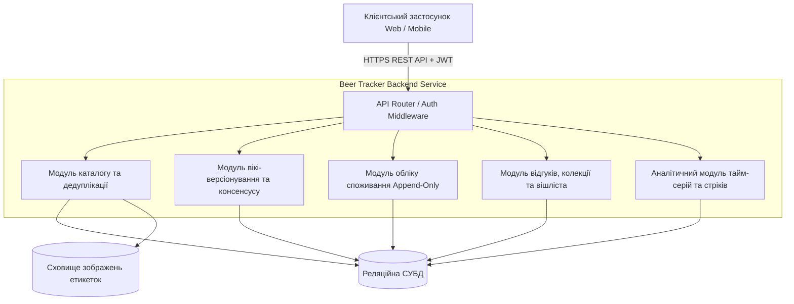
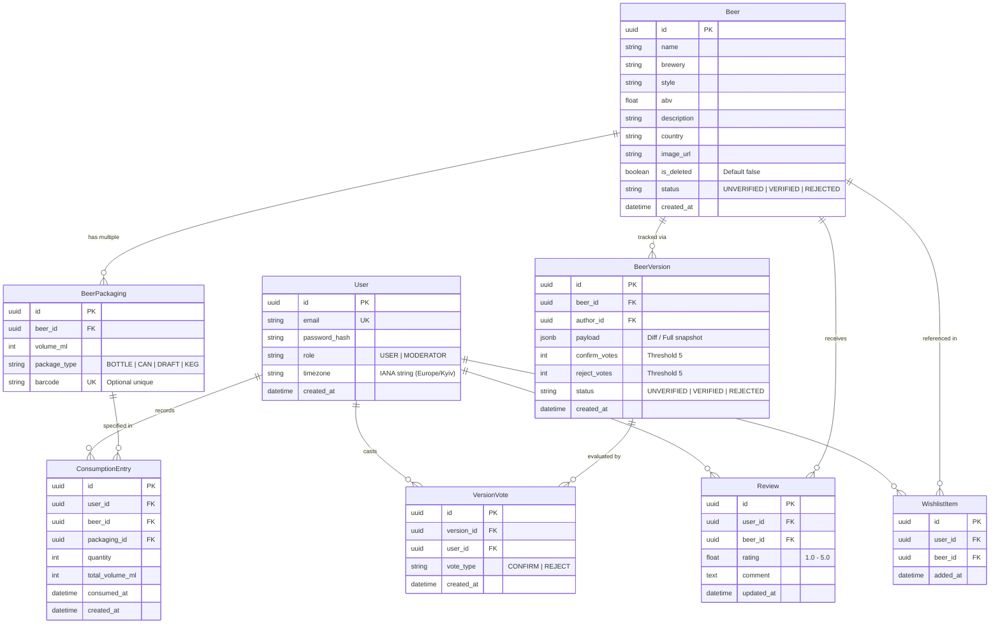

# Специфікація вимог до програмного забезпечення (SRS)
## Система обліку споживання пива та персонального каталогу (Beer Tracker Backend)
**Стандарт:** IEEE Std 830-1998  
**Версія документа:** 1.0.0  
**Статус:** Rejected  
**Дата випуску:** 2026-09-20  

---

## 1. Вступ (Introduction)

### 1.1. Призначення документа та системи
Цей документ містить повну специфікацію вимог до серверної частини (Backend API) системи "Beer Tracker". Специфікація встановлює формальні вимоги до функціональності, інтерфейсів, продуктивності, безпеки та надійності системи й слугує обов'язковим контрактом для проектування, розробки, автоматизованого тестування та приймання продукту.

Система "Beer Tracker" — це серверний застосунок, що поєднує можливості точного кількісного обліку вжитих напоїв (у формі незмінного журналу транзакцій) та дегустаційного щоденника з персональною аналітикою та краудсорсинговим каталогом продукції на wiki-засадах.

### 1.2. Межі системи (Scope Boundaries)

#### 1.2.1. In-Scope (Гарантована функціональність поточної версії)
1. **Керування каталогом продукції (Wiki-модель):**
   - Реєстрація сортів пива з обов'язковими атрибутами (назва, виробник, стиль, міцність ABV, перелік варіантів тари);
   - Відокремлений облік розливного пива (`Draft Beer`) як самостійного товару каталогу;
   - Підтримка множинних пакувань (`Packaging`: об'єм у мл, тип тари, асоційовані штрих-коди);
   - Автодоповнення та вибір із бази існуючих виробників та стилів;
   - Превентивна дедуплікація за штрих-кодом або комбінацією `(brewery + name)` зі статусом `409 Conflict`.
2. **Вікі-версіонування та консенсусна крауд-модерація:**
   - Фіксація модифікацій існуючих товарів через чернетки версій (`BeerVersion`);
   - Краудсорсингове голосування користувачів (`Confirm` / `Reject`) із порогом верифікації/відхилення $N=5$;
   - Заборона автоголосування (автор не може оцінювати власні версії);
   - Автоматична верифікація версії з деактивацією застарілої;
   - Відхилення чернеток: видалення неузгоджених правок до існуючих товарів та переведення нових сумнівних продуктів у статус `Rejected` (черга розгляду модератора);
   - Адміністративні привілеї модератора (миттєве затвердження/видалення).
3. **Кількісний облік споживання (Append-Only Log):**
   - Фіксація фактів вживання із зазначенням пакування, кількості одиниць та мітки часу;
   - Автоматичний розрахунок сумарного об'єму в мілілітрах ($ml$);
   - Абсолютна незмінність журналу споживання: повна заборона методів `PUT`, `PATCH`, `DELETE` на рівні API та СУБД;
   - Сувора конфіденційність та ізоляція логів між користувачами.
4. **Рейтинги, відгуки, дегустаційна колекція та Wishlist:**
   - Публікація оцінки (1.0–5.0) та відгуку строго після фіксації факту споживання продукту;
   - Правило єдиного відгуку на продукт від одного користувача з можливістю подальшої модифікації;
   - Автоматичне формування персональної колекції (`Collection`) на основі фактів споживання;
   - Ведення списку бажань (`Wishlist`) із детермінованим автоматичним видаленням товару при першому вживанні.
5. **Адміністративне обслуговування та збереження цілісності:**
   - М'яке видалення (Soft Delete) продуктів із підстановкою сутності-заглушки (`Placeholder Beer`), що зберігає історичний літраж користувача;
   - Злиття дублікатів (`Merge`) із перенесенням транзакцій споживання та збереженням новішого відгуку.
6. **Аналітичний часовий модуль:**
   - Розрахунок аналітики в розрізі збереженого IANA-часового поясу користувача;
   - Фіксація межі зміни доби (`Day Boundary`) рівно о `00:00:01` локального часу;
   - Обчислення поточного (`Current Streak`) та максимального (`Longest Streak`) стріків днів споживання;
   - Агрегації споживання за день, тиждень, місяць або обраний проміжок дат;
   - Добовий погодинний профіль споживання (0–23 години) та середньоісторичний розподіл.
7. **Автентифікація та авторизація:**
   - Автентифікація на основі JWT (Access/Refresh токени з ротацією);
   - Рольова модель (Guest, User, Moderator).

#### 1.2.2. Out-of-Scope (Свідомо виключено з поточної версії)
1. ❌ **Графічні інтерфейси:** Клієнтські застосунки (Web SPA, iOS, Android). Реалізується виключно headless REST API.
2. ❌ **Серверне розпізнавання образів (OCR / CV):** Автоматичне сканування етикеток за фотографіями на бекенді. Клієнт передає готовий числовий рядок штрих-коду або URL завантаженого зображення.
3. ❌ **Зовнішні інтеграції:** Імпорт або синхронізація з Untappd, RateBeer, Open Food Facts. База ведеться автономно за принципом wiki.
4. ❌ **Токсикологічні розрахунки:** Розрахунок вмісту алкоголю в крові (BAC / проміле), часу протверезіння чи врахування фізіологічних параметрів користувача. Обчислюється лише фізичний об'єм напою ($ml$).
5. ❌ **Соціальні механіки:** Стрічка активності (feed), система друзів, обмін повідомленнями, коментування чужих відгуків, лайки.
6. ❌ **Комерційні функції та геодані:** Облік цін, сканування фіскальних чеків, геолокація закладів, картографічні сервіси, оплата.
7. ❌ **Редагування/видалення логів споживання:** Будь-які запити на зміну вже зафіксованої історії споживання відхиляються за дизайном системи.

---

### 1.3. Глосарій предметної області (Domain Glossary / Ubiquitous Language)

| Термін (Ubiquitous Language) | Офіційне визначення в системі | Дозволені синоніми | ❌ ЗАБОРОНЕНІ синоніми | Bounded Context |
| :--- | :--- | :--- | :--- | :--- |
| **`Beer`** | Канонічна сутність напою в каталозі: стабільний `id`, назва, броварня, стиль, ABV, перелік доступних пакувань. | Напій, Продукт, Товар | `Drink`, `AlcoholItem`, `Good`, `Bottle` | **Catalog** |
| **`Draft Beer`** | Окремий сорт у каталозі, призначений виключно для обліку розливного пива (відокремлений від фасованих аналогів). | Розливне пиво | `Tap`, `OnTapItem` | **Catalog** |
| **`Packaging`** (`BeerPackaging`) | Варіант тари конкретного `Beer` із фіксованим об'ємом у мл, типом упаковки та опціональним штрих-кодом. | Тара, Варіант пакування | `SKU`, `Size`, `VolumeOption` | **Catalog** |
| **`BeerVersion`** | Пропозиція змін або чернетка продукту `Beer`, створена користувачем, що очікує верифікації спільнотою або модератором. | Чернетка товару, Версія | `Draft` *(щоб не плутати з Draft Beer)*, `Modification` | **Moderation** |
| **`ConsumptionEntry`** | Незмінний факт індивідуального споживання певної кількості одиниць конкретного `Packaging` у вказаний момент часу. | Лог споживання, Факт споживання | `Order`, `DrinkEvent`, `IntakeLog`, `Transaction` | **Consumption Tracking** |
| **`Review`** | Оцінка (1.0–5.0) та відгук користувача на конкретний `Beer`. Може бути лише один на пару `(User, Beer)` і тільки після вживання. | Відгук, Оцінка | `Feedback`, `Comment`, `Impression` | **Review & Rating** |
| **`Wishlist`** (`WishlistItem`) | Персональний список сортів пива, які користувач має намір скуштувати в майбутньому. | Список бажань | `Favorites`, `Bookmarks`, `Cart`, `ToBuy` | **Personal Collection** |
| **`Collection`** (`Tasted Collection`) | Автоматично сформована віртуальна множина всіх унікальних `Beer`, щодо яких користувач має хоча б один лог споживання. | Дегустаційна колекція, Список скуштованого | `History`, `Cellar` | **Personal Collection** |
| **`VersionVote`** | Голос автентифікованого користувача (`Confirm` або `Reject`) за або проти запропонованої `BeerVersion`. | Голос верифікації | `Like`, `Dislike`, `RatingVote` | **Moderation** |
| **`Streak`** | Неперервна послідовність календарних діб (за таймзоною користувача), у кожній з яких зафіксовано $\ge 1$ факт споживання. | Серія днів споживання | `DayChain`, `ContinuousDays`, `Session` | **Analytics** |
| **`Day Boundary`** | Точка початку нової календарної доби для аналітики — фіксується рівно о `00:00:01` місцевого часу користувача. | Межа доби | `Midnight` *(бо опівніч це 00:00:00)* | **Analytics** |
| **`Placeholder Beer`** | Системний стан запису, що підставляється замість видаленого товару для збереження цілісності історичних логів споживання. | Заглушка, "Видалений продукт" | `NullBeer`, `DeletedItem`, `Ghost` | **Data Integrity** |
| **`Merge`** | Дія об'єднання дубліката (`source_beer`) з канонічним продуктом (`target_beer`) із перенесенням історії споживання та оновленням відгуку. | Злиття товарів | `Combine`, `Join`, `Relink` | **Data Integrity** |

---

## 2. Загальний опис (Overall Description)

### 2.1. Перспектива продукту та контекст
Система "Beer Tracker" функціонує як незалежний бекенд-сервіс, доступний через протокол HTTPS. Архітектура спирається на REST API зі збереженням стану в реляційній СКБД та об'єктному сховищі для медіафайлів (фото етикеток).



### 2.2. Характеристики користувачів (Ролі та права)
У системі діє рольова модель доступу (RBAC):

| Дія / Ендпоінт | Гість (`Guest`) | Користувач (`User`) | Модератор (`Moderator`) |
| :--- | :---: | :---: | :---: |
| Реєстрація та автентифікація | ✅ | ✅ | ✅ |
| Перегляд каталогу та відгуків | ✅ | ✅ | ✅ |
| Пошук та автодоповнення по каталогу | ✅ | ✅ | ✅ |
| Створення нового продукту (Unverified) | ❌ | ✅ | ✅ |
| Модифікація продукту (створення BeerVersion) | ❌ | ✅ | ✅ |
| Голосування за версію (Confirm/Reject) | ❌ | ✅ *(крім власних)* | ✅ |
| Миттєве затвердження версії (Verified) | ❌ | ❌ | ✅ |
| Видалення продукту (Soft Delete / Placeholder) | ❌ | ❌ | ✅ |
| Злиття дублікатів (Merge) | ❌ | ❌ | ✅ |
| Фіксація споживання (Append-Only Log) | ❌ | ✅ *(тільки власні)* | ✅ *(тільки власні)* |
| Додавання / видалення з Wishlist | ❌ | ✅ *(тільки власний)* | ✅ *(тільки власний)* |
| Написання / зміна відгуку (після споживання) | ❌ | ✅ *(1 на сорт)* | ✅ *(1 на сорт)* |
| Перегляд персональної аналітики та стріків | ❌ | ✅ *(тільки власна)* | ✅ *(тільки власна)* |

### 2.3. Загальні обмеження
1. **Технологічні обмеження:**
   - Взаємодія здійснюється суворо через RESTful API у форматі JSON;
   - Канонічною одиницею вимірювання об'єму є мілілітри ($ml$, ціле число). Конвертація в інші одиниці (пінти, унції) покладається на клієнт;
   - Часові мітки зберігаються в базі даних в UTC (ISO 8601).
2. **Бізнес-обмеження:**
   - Незмінність фактів споживання: записи журналу споживання захищені від модифікацій та видалень;
   - Обчислення доби для аналітики прив'язане до часового поясу IANA, зареєстрованого в профілі користувача;
   - Крауд-модерація керується детермінованим числовим порогом у 5 голосів ($N=5$).

---

## 3. Специфічні вимоги (Specific Requirements)

### 3.1. Функціональні вимоги (Functional Requirements)

#### REQ-F-001: Реєстрація нового продукту в каталозі
Система повинна надавати автентифікованому користувачеві можливість зареєструвати новий сорт пива, вказавши назву, виробника, стиль, ABV, опціональний опис, країну, зображення та перелік варіантів пакування.
* **AC-001.1:** При успішному створенні продукту система призначає йому початковий статус `Unverified` та генерує унікальний стабільний `id`.
* **AC-001.2:** Якщо запит не містить жодного пакування або хоча б одне пакування має об'єм $< 50$ мл чи $> 10000$ мл, система повертає код `400 Bad Request`.
* **AC-001.3:** Якщо створено продукт із типом тари `Draft`, система реєструє його як самостійний продукт типу `Draft Beer`.

#### REQ-F-002: Превентивна дедуплікація каталогу
Система повинна перевіряти унікальність нового продукту перед збереженням.
* **AC-002.1:** Якщо в каталозі вже існує активний продукт із такою ж парою `(brewery, name)` (без урахування регістру літер і крайніх пробілів), система повертає `409 Conflict`.
* **AC-002.2:** Якщо будь-який зі штрих-кодів у варіантах пакування вже асоційований з іншим продуктом, система повертає `409 Conflict` із зазначенням конфліктного штрих-коду.

#### REQ-F-003: Модифікація продукту через створення версії
Система повинна реєструвати всі пропозиції щодо зміни атрибутів існуючого товару (включно з додаванням нових пакувань) у формі окремої сутності `BeerVersion`.
* **AC-003.1:** При оновленні продукту створюється запис `BeerVersion` зі статусом `Unverified` та нульовими лічильниками голосів.
* **AC-003.2:** Запити на отримання картки товару за замовчуванням повертають найновішу запропоновану версію; за наявності параметра `verified_only=true` повертається остання версія `Verified`.

#### REQ-F-004: Краудсорсингове голосування за версію
Система повинна приймати голоси спільноти на підтримку (`Confirm`) або відхилення (`Reject`) чернетки версії товару.
* **AC-004.1:** Автор запропонованої версії отримує відповідь `403 Forbidden` при спробі проголосувати за власну версію.
* **AC-004.2:** Повторне голосування користувача за ту саму версію повертає помилку `409 Conflict`.
* **AC-004.3:** Дозволеними значеннями типу голосу є виключно `Confirm` (+1) або `Reject` (-1).

#### REQ-F-005: Автоматична верифікація та відхилення версій за консенсусом
Система повинна змінювати стан версії при наборі 5 однакових голосів.
* **AC-005.1:** При отриманні 5-го голосу `Confirm` версія отримує статус `Verified`. Якщо це оновлення існуючого товару, попередня верифікована версія деактивується.
* **AC-005.2:** Якщо версія-модифікація набирає 5 голосів `Reject`, вона видаляється з системи, а діюча верифікована версія залишається діяти.
* **AC-005.3:** Якщо абсолютно новий продукт набирає 5 голосів `Reject`, він отримує статус `Rejected` і виноситься в чергу розгляду модератора.

#### REQ-F-006: Реєстрація факту споживання (Append-Only)
Система повинна фіксувати факт споживання напою користувачем із прив'язкою до тари та кількості одиниць.
* **AC-006.1:** Сервер автоматично вираховує та зберігає підсумковий об'єм у мілілітрах як добуток `quantity * Packaging.volume_ml`.
* **AC-006.2:** Якщо часова мітка `consumed_at` вказує на майбутній час відносно серверного часу (`consumed_at > now()`), запит відхиляється з `400 Bad Request`.
* **AC-006.3:** При значеннях `quantity < 1` або `quantity > 100` повертається код `422 Unprocessable Entity`.

#### REQ-F-007: Заборона зміни та видалення логів споживання
Система повинна забезпечувати незмінність журналу споживання.
* **AC-007.1:** При спробі виклику HTTP-методів `PUT`, `PATCH` або `DELETE` на ендпоінтах споживання (`/api/v1/consumption/*`) сервер повертає статус `405 Method Not Allowed`.
* **AC-007.2:** Жодна сервісна операція над каталогом не призводить до видалення записів споживання з бази даних.

#### REQ-F-008: Написання та оновлення дегустаційного відгуку
Система повинна дозволяти користувачеві залишити публічну оцінку та відгук виключно після споживання напою.
* **AC-008.1:** При спробі публікації відгуку без наявності хоча б одного запису споживання цього товару в користувача сервер повертає `403 Forbidden`.
* **AC-008.2:** Числова оцінка повинна знаходитися в межах від 1.0 до 5.0 із кроком 0.5. Інші значення відхиляються з кодом `400 Bad Request`.
* **AC-008.3:** Користувач може мати не більше одного відгуку на конкретний товар; повторні звернення оновлюють існуючий запис відгуку.

#### REQ-F-009: Автоматичне формування колекції та автоочищення Wishlist
Система повинна автоматично синхронізувати особисті списки користувача.
* **AC-009.1:** При фіксації першого споживання продукту цей сорт пива автоматично додається до списку `Collection` користувача.
* **AC-009.2:** Якщо даний напій перебував у списку `Wishlist` користувача, він автоматично та безповоротно видаляється з `Wishlist` у тій же транзакції.

#### REQ-F-010: Видалення продукту модератором та Placeholder
Система повинна підтримувати безпечне вилучення товару модератором.
* **AC-010.1:** При видаленні товару модератором фізичний запис у базі не знищується: товар позначається як `is_deleted = true` і вилучається з пошуку каталогу та вішлістів.
* **AC-010.2:** В історії споживання користувачів видалений напій відображається під системною назвою "Видалений продукт" (`Placeholder Beer`) зі збереженням історичного об'єму та дати.

#### REQ-F-011: Злиття дублікатів (Merge)
Система повинна дозволяти модератору об'єднати два записи-дублікати.
* **AC-011.1:** Усі логи споживання, що посилалися на `source_beer_id`, атомарно переприв'язуються до `target_beer_id`.
* **AC-011.2:** Якщо користувач мав відгуки на обидва товари, зберігається новіший відгук (за датою модифікації), а старіший архівується.
* **AC-011.3:** Товар-дублікат `source_beer_id` позначається неактивним і приховується.

#### REQ-F-012: Розрахунок аналітики споживання та стріків
Система повинна агрегувати показники споживання з обов'язковим урахуванням часового поясу користувача.
* **AC-012.1:** Межа зміни доби визначається за зареєстрованим IANA-поясом користувача: споживання о `00:00:01` зараховується в новий календарний день (`Day Boundary`).
* **AC-012.2:** `Current Streak` обчислюється як неперервна кількість календарних днів споживання, що завершується поточною або вчорашньою датою користувача.
* **AC-012.3:** Система надає погодинний розподіл вживання (слоти 0–23 години) для обраної дати та середній історичний профіль споживання.

---

### 3.2. Вимоги до зовнішніх інтерфейсів (External Interfaces)

#### 3.2.1. Програмний інтерфейс (API Endpoints)
API відповідає принципам REST, використовує JSON та захищене Bearer-токенами:

| Метод | Шлях (URI) | Призначення | Доступ |
| :--- | :--- | :--- | :--- |
| `POST` | `/api/v1/auth/register` | Реєстрація нового користувача | Public |
| `POST` | `/api/v1/auth/login` | Отримання пари Access + Refresh токенів | Public |
| `POST` | `/api/v1/auth/refresh` | Оновлення токенів із ротацією Refresh токена | Public |
| `GET` | `/api/v1/beers` | Пошук та фільтрація в каталозі товарів | Public |
| `GET` | `/api/v1/beers/{id}` | Отримання детальної інформації про продукт | Public |
| `POST` | `/api/v1/beers` | Створення нового продукту (REQ-F-001) | User |
| `POST` | `/api/v1/beers/{id}/versions` | Запропонувати оновлення продукту (REQ-F-003) | User |
| `POST` | `/api/v1/beers/versions/{ver_id}/vote` | Голосування Confirm/Reject (REQ-F-004) | User |
| `POST` | `/api/v1/beers/versions/{ver_id}/verify` | Примусова верифікація модератором | Moderator |
| `DELETE`| `/api/v1/beers/{id}` | Видалення продукту (Soft Delete Placeholder) | Moderator |
| `POST` | `/api/v1/beers/merge` | Злиття дублікатів Merge (REQ-F-011) | Moderator |
| `GET` | `/api/v1/consumption` | Отримання журналу споживання користувача | User (Owner) |
| `POST` | `/api/v1/consumption` | Реєстрація факту споживання (REQ-F-006) | User (Owner) |
| `GET` | `/api/v1/consumption/analytics` | Календар, стріки, погодинний розподіл | User (Owner) |
| `GET` | `/api/v1/wishlist` | Отримання списку бажань користувача | User (Owner) |
| `POST` | `/api/v1/wishlist/{beer_id}` | Додавання продукту до списку бажань | User (Owner) |
| `DELETE`| `/api/v1/wishlist/{beer_id}` | Ручне видалення зі списку бажань | User (Owner) |
| `GET` | `/api/v1/collection` | Перегляд дегустаційної колекції (Tasted) | User (Owner) |
| `POST` | `/api/v1/reviews/{beer_id}` | Створення або зміна відгуку (REQ-F-008) | User |
| `DELETE`| `/api/v1/reviews/{beer_id}` | Видалення власного відгуку | User |

#### 3.2.2. Концептуальна реляційна модель даних (Data ERD)



---

### 3.3. Нефункціональні вимоги (Non-Functional Requirements)

#### 3.3.1. Продуктивність (Performance)
* **REQ-NF-001 (Швидкодія каталогу):**
  Час обробки запитів пошуку, отримання картки товару та фільтрації повинен становити $p95 \le 100$ мс, $p99 \le 200$ мс при стабільному навантаженні **100 RPS**.
* **REQ-NF-002 (Швидкодія аналітики та стріків):**
  Час обчислення календаря споживання, поточної та максимальної серій днів (стріків) повинен складати $p95 \le 250$ мс при навантаженні **30 RPS** для користувачів із базою споживання до **$10\,000$ транзакцій**.
* **REQ-NF-003 (Пропускна здатність на запис):**
  Сервер повинен витримувати навантаження не менше **50 Write RPS** на створення записів споживання з латентністю $p95 \le 150$ мс.

#### 3.3.2. Безпека (Security)
* **REQ-NF-004 (Автентифікація та ротація токенів):**
  Автентифікація реалізується за протоколом stateless JWT. Термін життя `Access Token` — не більше 15 хвилин, `Refresh Token` — 30 днів із обов'язковою одноразовою ротацією при кожному оновленні.
* **REQ-NF-005 (Ізоляція приватних даних споживача):**
  Записи логів споживання та вміст вішліста є суворо приватними. Будь-яка спроба звернутися до чужих логів через підміну ідентифікатора повертає код `403 Forbidden` або `404 Not Found`.
* **REQ-NF-006 (Криптографічний захист паролів):**
  Паролі користувачів зберігаються виключно у вигляді солених хешів на базі алгоритму **Argon2id** або **BCrypt** із фактором складності не менше 12.

#### 3.3.3. Надійність та обробка помилок (Reliability & Fault Tolerance)
* **REQ-NF-007 (ACID транзакційність):**
  Операції злиття дублікатів (`Merge`) та паралельного створення запису споживання з оновленням колекції та видаленням із `Wishlist` повинні виконуватися в рамках ACID-транзакцій з рівнем ізоляції не нижче `Read Committed` з гарантією повного відкату при збоях.
* **REQ-NF-008 (Стандартизований формат помилок RFC 7807):**
  Усі помилки клієнта (4xx) та сервера (5xx) повертаються за стандартом `application/problem+json` із полями `type`, `title`, `status`, `detail`, `instance` та масивом `invalid_params`.
* **REQ-NF-009 (Запобігання гонкам даних при голосуванні):**
  Спроби одночасного надсилання кількох голосів користувачем блокуються на рівні бази даних через унікальний індекс `(user_id, version_id)`.

---

## 4. Поведінкові моделі та сценарії (Behavior Models)

### 4.1. BDD-сценарії (Behavior-Driven Development)

#### BDD-SCN-001: Фіксація факту споживання та автоочищення Wishlist (Happy Path)
```gherkin
Scenario: BDD-SCN-001 - Фіксація споживання пива зі списку бажань
  Given користувач "user@example.com" автентифікований у системі
    And напій "Mova Dark Stout" присутній у списку "Wishlist" користувача
    And напій "Mova Dark Stout" має пакування "Банка 500 мл" (volume_ml: 500)
  When користувач надсилає запит на додавання запису споживання:
    | beer_name        | packaging      | quantity | consumed_at          |
    | Mova Dark Stout  | Банка 500 мл   | 2        | 2026-09-20T20:30:00Z |
  Then сервер повертає статус відповіді 201 Created
    And створений запис містить обчислений total_volume_ml рівний 1000
    And напій "Mova Dark Stout" автоматично додається до списку "Collection" користувача
    And напій "Mova Dark Stout" більше не присутній у списку "Wishlist" користувача
```

#### BDD-SCN-002: Автоматична верифікація версії продукту спільнотою (Happy Path)
```gherkin
Scenario: BDD-SCN-002 - Автоматичне затвердження версії при досягненні 5 підтверджень
  Given у системі існує сорт "Varvar IPA" із верифікованою версією v1
    And користувач "contributor@example.com" створив модифікацію v2 (додано пакування "Пляшка 330 мл")
    And версія v2 наразі має статус "Unverified" та 4 голоси "Confirm"
    And користувач "voter5@example.com" ще не голосував за версію v2
  When користувач "voter5@example.com" відправляє голос "Confirm" за версію v2
  Then сервер повертає статус 200 OK
    And версія v2 автоматично змінює статус на "Verified"
    And версія v1 позначається як застаріла та деактивується
    And наступні запити до каталогу повертають версію v2 як діючу верифіковану базу
```

#### BDD-SCN-003: Відхилення спроби створення відгуку без факту споживання (Edge Case / Access Error)
```gherkin
Scenario: BDD-SCN-003 - Заборона публікації відгуку на нескуштований напій
  Given користувач "critic@example.com" автентифікований у системі
    And напій "Underwood Kyiv Lager" зареєстрований у каталозі
    And користувач "critic@example.com" не має жодного запису споживання для "Underwood Kyiv Lager"
  When користувач надсилає запит на створення відгуку:
    | beer_name             | rating | comment                    |
    | Underwood Kyiv Lager  | 4.5    | "Чудовий класичний лагер"  |
  Then сервер повертає статус відповіді 403 Forbidden
    And тіло відповіді містить код помилки "ERR_CONSUMPTION_REQUIRED"
    And у профілі напою "Underwood Kyiv Lager" новий відгук не створюється
```

#### BDD-SCN-004: Блокування дубліката продукту за існуючим штрих-кодом (Edge Case / Conflict)
```gherkin
Scenario: BDD-SCN-004 - Запобігання реєстрації дубліката за зареєстрованим штрих-кодом
  Given у каталозі вже існує продукт "Pilsner Urquell" із штрих-кодом "8594404110123"
  When користувач намагається створити новий продукт:
    | name             | brewery           | style   | abv | barcode       |
    | Urquell Original | Plzensky Prazdroj | Pilsner | 4.4 | 8594404110123 |
  Then сервер відхиляє запит зі статусом 409 Conflict
    And тіло помилки стандарту RFC 7807 містить:
      | field   | detail                                                      |
      | barcode | "Штрих-код 8594404110123 уже прив'язаний до іншого товару" |
    And новий продукт не зберігається в базі даних
```

#### BDD-SCN-005: Заборона модифікації або видалення логу споживання (Edge Case / Append-Only Violation)
```gherkin
Scenario: BDD-SCN-005 - Блокування запитів модифікації журналу споживання
  Given користувач має існуючий запис споживання з ідентифікатором "c0a80123-0001"
  When користувач надсилає HTTP PUT запит на ендпоінт "/api/v1/consumption/c0a80123-0001":
    | quantity | 1 |
  Then сервер повертає статус 405 Method Not Allowed
  When користувач надсилає HTTP DELETE запит на ендпоінт "/api/v1/consumption/c0a80123-0001"
  Then сервер повертає статус 405 Method Not Allowed
    And запис "c0a80123-0001" залишається без змін у системі
```
