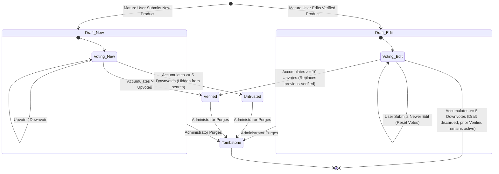
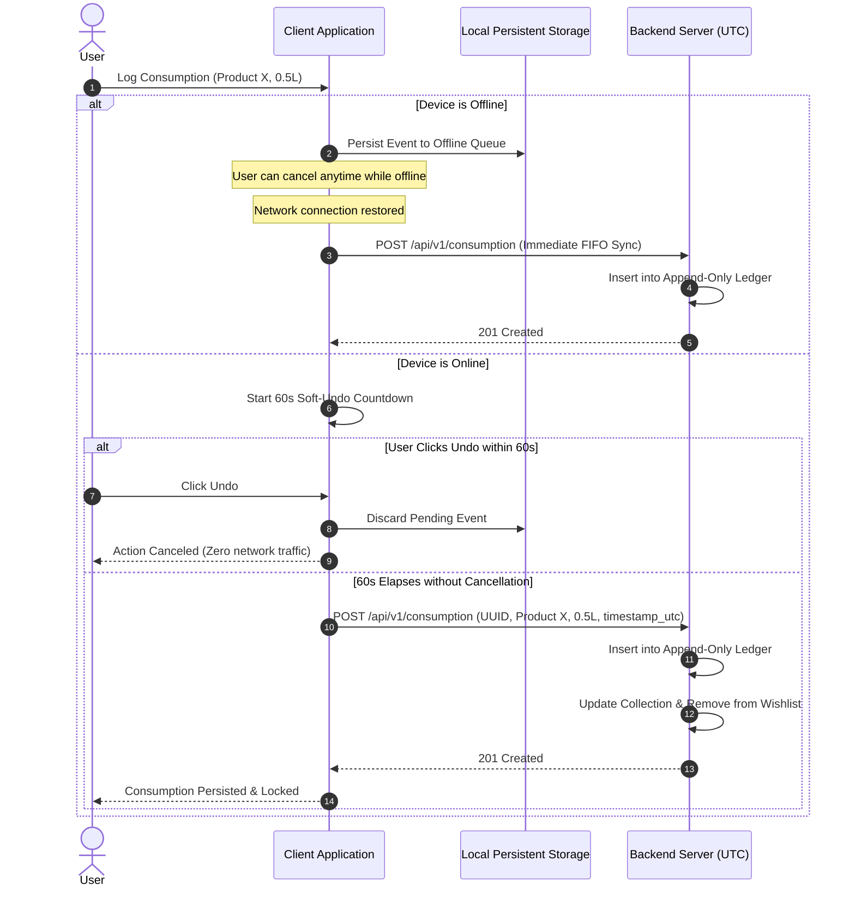

# Software Requirements Specification (SRS)
## Beer Consumption Tracking and Personal Catalog System

**Document Version:** 1.1  
**Status:** Approved  
**Standard:** IEEE Std 830-1998 Compliant  
**Date:** September 20, 2026  

---

## Table of Contents
1. [Introduction](#1-introduction)  
   1.1. [Purpose of the Document and System](#11-purpose-of-the-document-and-system)  
   1.2. [System Scope Boundaries (In-Scope / Out-of-Scope)](#12-system-scope-boundaries-in-scope--out-of-scope)  
   1.3. [Domain Glossary (Ubiquitous Language)](#13-domain-glossary-ubiquitous-language)  
2. [Overall Description](#2-overall-description)  
   2.1. [Product Perspective and Context](#21-product-perspective-and-context)  
   2.2. [User Characteristics and Role Permissions](#22-user-characteristics-and-role-permissions)  
   2.3. [General Constraints (Technological and Regulatory)](#23-general-constraints-technological-and-regulatory)  
3. [Specific Requirements](#3-specific-requirements)  
   3.1. [Functional Requirements (REQ-F-xxx with Acceptance Criteria)](#31-functional-requirements-req-f-xxx-with-acceptance-criteria)  
   3.2. [External Interface Requirements (UI / API / Data)](#32-external-interface-requirements-ui--api--data)  
   3.3. [Non-Functional Requirements (REQ-NF-xxx)](#33-non-functional-requirements-req-nf-xxx)  
4. [Behavioral Models and Scenarios](#4-behavioral-models-and-scenarios)  
   4.1. [BDD Scenarios (Given-When-Then)](#41-bdd-scenarios-given-when-then)  
   4.2. [Consensus Verification State Machine](#42-consensus-verification-state-machine)  
   4.3. [Consumption Ingestion and Soft-Undo Sequence](#43-consumption-ingestion-and-soft-undo-sequence)  

---

## 1. Introduction

### 1.1. Purpose of the Document and System
This Software Requirements Specification (SRS) document provides a formal, complete, and unambiguous definition of the requirements for the **Beer Consumption Tracking and Personal Catalog System**. It complies with the format and quality guidelines established in **IEEE Std 830-1998**.

The primary purpose of the system is to automate the logging of consumed beer volumes and maintain a personal qualitative tasting journal, supported by a crowdsourced, wiki-style global catalog of beer products. The system combines financial-grade event immutability for consumption records with community-driven consensus governance for catalog entities.

This specification serves as the binding contract for system architects, software developers, quality assurance engineers, and administrative stakeholders throughout all phases of design, implementation, verification, and deployment.

---

### 1.2. System Scope Boundaries (In-Scope / Out-of-Scope)

To prevent scope creep and ensure deterministic architectural boundaries, the capabilities of Version 1.1 are explicitly partitioned into In-Scope and Out-of-Scope boundaries.

#### 1.2.1. In-Scope (Committed Capabilities)
1. **User Identity & Sybil Defense:**
   * User authentication via JSON Web Tokens (JWT).
   * Registration throttling (IP rate-limiting) and CAPTCHA / email verification to prevent bot farm proliferation.
   * Account maturity gating (minimum account age of 48 hours AND at least 1 confirmed `ConsumptionEvent`) required before granting catalog editing and consensus voting privileges.
   * Daily submission rate-limiting (maximum of 5 new product creation requests per user per 24 hours).
2. **Crowdsourced Catalog & Dual-Version Lifecycle:**
   * Global wiki-style beer catalog with community contributions.
   * Dual-version concurrency: a product record maintains at most two active states simultaneously (exactly one `VerifiedVersion` and at most one pending `DraftVersion`).
   * User catalog presentation toggle: switch between "Latest (Draft/Unverified)" (default) and "Verified Only".
   * Consensus voting engine: 10 `UPVOTE` votes elevate a `DraftVersion` to `VerifiedVersion`; 5 `DOWNVOTE` votes reject a `DraftVersion`.
   * Conflict & author voting rules: authors cannot vote on their own submissions; maximum 1 vote per user per draft version.
   * Concurrency race resolution: pessimistic row locking (`SELECT FOR UPDATE`) enforces First-Commit Wins.
   * Rejection handling: rejecting an edit reverts to the active `VerifiedVersion` baseline; rejecting a brand-new submission transitions it to `Untrusted` (hidden from global search, preserved for existing loggers).
   * Author anonymity: creator user IDs are preserved in internal audit tables for security inspection, but are strictly redacted from public APIs and UI views.
   * Administrative purge with Tombstone substitution: deleting fraudulent products invokes a privileged stored procedure (`SECURITY DEFINER`) to replace references with a standardized placeholder (`[Deleted / Unknown Product]`), maintaining consumption immutability for standard application connection pools.
3. **Deduplication & Product Normalization:**
   * Hard duplicate rejection via barcode uniqueness (EAN-13, UPC).
   * Normalized compound key validation: `lowercase(trim(name)) + lowercase(trim(brewery)) + serving_type`.
   * Multi-packaging support: a single packaged beer binds multiple package variants and volumes; draft (on-tap) beer is modeled as an independent product entity.
4. **Quantitative Consumption Tracking:**
   * Append-only consumption ledger recording: `event_id`, `user_id`, `product_id`, `volume_liters`, and `timestamp_utc`.
   * Strict server-side immutability: standard application database pools have strictly `INSERT` and `SELECT` permissions.
   * Client-side Soft-Undo: 60-second countdown timer on the client for online entries; canceling within 60 seconds discards the record locally before network transmission.
   * Offline-first event buffering: offline logs are persisted in client-side non-volatile storage (IndexedDB/SQLite); upon network reconnection, queued events sync immediately to the server with their original UTC creation timestamps.
5. **Personal Collection & Tasting Diary:**
   * Wishlist management: ability to manually add and remove catalog products to/from a personal `Wishlist`.
   * Automatic Collection formation: the first committed consumption event automatically moves a product from `Wishlist` to `Collection`.
   * Soft-Undo cancellation: canceling the first online consumption within the 60-second window cancels `Collection` addition and preserves `Wishlist` status.
   * Single review per product per user: rating scale 1.0 to 5.0 with 0.5 increments; optional text comment ($\le 2000$ characters); fully editable and deletable by the author.
   * Review prerequisite: reviews are strictly restricted to products present in the user's personal `Collection`.
   * Public product aggregate display: arithmetic mean rating, review count, and requesting user's personal rating.
6. **Localized Consumption Analytics:**
   * Volume aggregates: total Liters consumed for the current day, current week, and current month.
   * Local timezone normalization: UTC timestamps converted to the client's local IANA timezone for calendar boundaries (00:00:00 to 23:59:59). Unrecognized timezone strings return HTTP 400 Bad Request.
   * Drinking streak calculation: `CurrentStreak` and `LongestStreak` in consecutive local calendar days.
   * Calendar heatmap data: API endpoint returning local calendar dates with recorded consumption events.
   * Hourly distribution: 24-hour histogram for a selected local calendar day and historical average hourly profile.
   * Frequency-based top rankings: Top Beers, Breweries, and Styles ranked strictly by consumption count and volume. Ties broken strictly by most recent consumption date (`last_consumed_at DESC`).

#### 1.2.2. Out-of-Scope (Strictly Excluded / Deferred)
* **External Catalog APIs:** No integrations with Untappd, RateBeer, Open Food Facts, or third-party barcode databases. The catalog is self-contained and crowdsourced.
* **Biometric & Health Calculations:** No computation of pure ethanol grams ($C_2H_5OH$), no Blood Alcohol Concentration (BAC) estimation, no calorie counting, and no sync with Apple Health or Google Health Connect.
* **Social Networking Features:** No public user profiles, no friend requests, no public activity streams, no direct messaging, no following other users, and no commenting on others' reviews.
* **Retail & Commercial Inventory:** No price tracking, currency conversions, venue tap-lists, bar location finders, bottle shop stock tracking, or receipt scanning (OCR).
* **Retroactive Server-Side Editing:** No API endpoints or UI permitting standard users to edit or delete historical consumption records once committed to the server.
* **Complex Sensory Profiling:** No spider/radar charts, BJCP sensory wheels, SRM color spectrum analyzers, or structured flavor tags.
* **Gamification Subsystems:** No unlockable badges, XP/leveling, or competitive leaderboards comparing users against each other.

---

### 1.3. Domain Glossary (Ubiquitous Language)

The terminology defined below establishes the **Ubiquitous Language** for this system. These terms must be used consistently across requirements, architecture, code models, database tables, REST APIs, and automated tests.

| Term (Canonical) | Definition | Allowed Synonyms | Forbidden Synonyms *(DO NOT USE)* | Usage Context |
| :--- | :--- | :--- | :--- | :--- |
| **`BeerProduct`** | A distinct beer formulation defined by its name, brewery, style, ABV, and serving category. | `Product` | *Item*, *Drink*, *Beverage*, *BeerEntry* | Domain Model, DB Table (`beer_products`), REST API (`/api/v1/products`) |
| **`ServingType`** | Classification of how the beer is packaged and served: pre-packaged (`PACKAGED`) or on-tap (`DRAFT`). | `PackagingCategory` | *Type*, *Container*, *Kind* | Domain Enum (`ServingType.PACKAGED`, `ServingType.DRAFT`), DB Column |
| **`PackageVariant`** | A physical packaging manifestation of a `PACKAGED` beer, defined by volume (ml/L) and an associated barcode. | `ProductPackage` | *Bottle*, *Can*, *SKU*, *Unit* | Domain Model, DB Table (`product_package_variants`) |
| **`ConsumptionEvent`** | A single immutable record of a user drinking a specific volume of a `BeerProduct` at a specific point in time. | `ConsumptionLog`, `Consumption` | *DrinkLog*, *CheckIn*, *Intake*, *Transaction* | Domain Model, DB Table (`consumption_events`), REST API (`/api/v1/consumption`) |
| **`SoftUndo`** | A client-side mechanism that buffers a newly logged online `ConsumptionEvent` for 60 seconds before committing it to the server. | `UndoBuffer`, `PendingSubmission` | *Rollback*, *DeleteConsumption*, *CancelRequest* | Client Service, UI Component (`SoftUndoBanner`) |
| **`OfflineQueue`** | Persistent local client storage (IndexedDB/SQLite) retaining uncommitted `ConsumptionEvent` records created while disconnected. | `ClientEventQueue` | *OfflineCache*, *DraftEvents*, *SyncBuffer* | Client Architecture, Sync Manager |
| **`Collection`** | The personal catalog of unique `BeerProduct` records that an individual user has consumed at least once in the system. | `TastedList`, `PersonalCollection` | *Library*, *Inventory*, *BeerCellar*, *History* | Domain Entity, DB Table (`user_collections`), UI View |
| **`Wishlist`** | A user-curated set of `BeerProduct` records that the user intends to taste in the future. | `ToTasteList` | *Favorites*, *Bookmarks*, *Watchlist*, *Cart* | Domain Entity, DB Table (`user_wishlists`), UI View |
| **`Review`** | A user's qualitative evaluation of a `BeerProduct` in their `Collection`, comprising a numerical rating and an optional text comment. | `TastingReview` | *Feedback*, *Comment*, *Critique*, *Post* | Domain Model, DB Table (`product_reviews`), REST API (`/api/v1/reviews`) |
| **`Rating`** | The numerical component of a `Review`, strictly constrained to the range 1.0 to 5.0 with step 0.5. | `Score`, `RatingScore` | *Stars*, *Grade*, *Mark*, *Points* | Domain Value Object, DTO Field |
| **`VerifiedVersion`** | The authoritative, community-approved version of a `BeerProduct` record that has reached the consensus threshold. | `VerifiedRecord` | *ApprovedVersion*, *FinalVersion*, *MasterRecord* | Domain Entity, DB Column (`verification_status = 'VERIFIED'`) |
| **`DraftVersion`** | A newly submitted or edited version of a `BeerProduct` awaiting verification through community consensus. | `PendingDraft`, `UnverifiedVersion` | *TempProduct*, *ProposedVersion*, *WorkingCopy* | Domain Entity, DB Column (`verification_status = 'DRAFT'`) |
| **`Untrusted`** | Lifecycle status of a new `BeerProduct` that received $\ge 5$ rejection votes; hidden from global discovery but preserved for existing loggers. | `QuarantinedProduct` | *Spam*, *Blacklisted*, *RejectedProduct*, *SoftDeleted* | Domain Status Enum (`VerificationStatus.UNTRUSTED`) |
| **`ConsensusVote`** | A binary evaluation (`UPVOTE` or `DOWNVOTE`) cast by an eligible user on a `DraftVersion`. | `VerificationVote` | *Like*, *Dislike*, *Approval*, *ReviewVote* | Domain Model, DB Table (`consensus_votes`), REST API |
| **`Tombstone`** | An immutable system placeholder entity (`[Deleted / Unknown Product]`) that replaces products purged by an Administrator. | `PlaceholderProduct` | *NullObject*, *GhostProduct*, *DummyBeer* | Domain Entity, Seed Data (`product_id = 0` or UUID nil) |
| **`DrinkingDay`** | A calendar day (00:00:00 to 23:59:59 in the user's local IANA timezone) containing at least one committed `ConsumptionEvent`. | `ActiveDay` | *AlcoholDay*, *BeerDay*, *Session* | Analytics Domain, DTO (`DrinkingDayDTO`) |
| **`Streak`** | A consecutive series of `DrinkingDay` intervals without intermediate interruption. Comprises `CurrentStreak` and `LongestStreak`. | `DrinkingStreak` | *Habit*, *Chain*, *Run*, *Series* | Analytics Domain, DTO (`StreakSummaryDTO`) |
| **`AccountMaturity`** | Security gate state requiring account age $\ge 48$ hours and $\ge 1$ committed consumption before granting catalog editing/voting privileges. | `UserMaturityStatus` | *TrustScore*, *Karma*, *UserRank*, *Level* | Security Filter, User Domain (`isMatured()`) |
| **`ABV`** | Alcohol by Volume: standard international metric expressing ethanol percentage in total liquid volume at 20°C. | `AlcoholPercentage` | *Proof*, *Strength*, *AlcoholContent* | Domain Value Object, DTO Field |
| **`CAPTCHA`** | Completely Automated Public Turing test to tell Computers and Humans Apart: automated challenge-response verification mechanism. | `AntiBotChallenge` | *BotFilter*, *HumanTest* | Security Filter, Auth API |
| **`EAN-13 / UPC`** | International Article Number (13 digits) and Universal Product Code (12 digits): global standard optical barcode symbologies. | `Barcode` | *Code*, *ProductCode*, *Serial* | Domain Field, DTO Field |

---

## 2. Overall Description

### 2.1. Product Perspective and Context
The system operates as a distributed, multi-tenant client-server application. The backend server functions as the **single source of truth** for user authentication, crowdsourced catalog data, community voting consensus, immutable consumption logs, and analytical aggregations.

The client application interacts with the server via an HTTPS REST API. The client maintains a local persistent queue allowing consumption logging during intermittent network loss, alongside a 60-second Soft-Undo buffer that ensures users can intercept and cancel unintentional online entries locally.

```
+--------------------------------------------------------------------------+
|                               Client Tier                                |
|  +----------------------+ +--------------------+ +--------------------+  |
|  | Consumption Tracker  | |  Wiki-Style Catalog| | Tasting Diary & Bio|  |
|  +----------------------+ +--------------------+ +--------------------+  |
|  +----------------------+ +--------------------+                         |
|  |  Offline Event Queue | |  Soft-Undo Timer   |                         |
|  |  (IndexedDB/SQLite)  | |  (60-second Buffer)|                         |
|  +----------------------+ +--------------------+                         |
+-------------------------------------+------------------------------------+
                                      | HTTPS / TLS 1.3 / JSON REST API
                                      v
+--------------------------------------------------------------------------+
|                               Server Tier                                |
|  +-----------------------+ +--------------------+ +--------------------+ |
|  | Identity & Anti-Abuse | | Consensus Engine   | | Analytics Engine   | |
|  | (JWT, Rate Limits)    | | (10 Up / 5 Down)   | | (UTC to IANA Local)| |
|  +-----------------------+ +--------------------+ +--------------------+ |
|  +---------------------------------------------------------------------+ |
|  |                     Relational Storage (ACID RDBMS)                 | |
|  |  - beer_products (Verified & Draft)   - consensus_votes             | |
|  |  - consumption_events (Append-Only)   - product_reviews             | |
|  |  - product_audit_ledger (Author ID)   - user_collections & wishlist | |
|  |  - privileged stored procedures (SECURITY DEFINER Tombstone purge)  | |
|  +---------------------------------------------------------------------+ |
+--------------------------------------------------------------------------+
```

---

### 2.2. User Characteristics and Role Permissions

The system defines two primary user classes: **Standard User** and **Administrator**. Unauthenticated users have no access to the system.

| Capability / Operation | Standard User (Immature) | Standard User (Mature: $\ge 48\text{h}$ + $\ge 1$ Logged Consumption) | Administrator |
| :--- | :---: | :---: | :---: |
| **Authenticate & Maintain Profile** | Allowed | Allowed | Allowed |
| **Browse Catalog (Verified & Draft)** | Allowed | Allowed | Allowed |
| **Log Consumption (Soft-Undo & Offline)** | Allowed | Allowed | Allowed |
| **Manage Personal Wishlist & Collection**| Allowed | Allowed | Allowed |
| **Rate & Review Consumed Products** | Allowed | Allowed | Allowed |
| **View Personal Consumption Analytics** | Allowed | Allowed | Allowed |
| **Submit New Beer Product / Edit Draft** | **Blocked** (HTTP 403) | Allowed (Max 5/day) | Allowed (Uncapped) |
| **Vote in Consensus (Upvote / Downvote)** | **Blocked** (HTTP 403) | Allowed (1 vote/version) | Allowed |
| **Inspect Creator Identity Audit Logs** | **Blocked** | **Blocked** | Allowed |
| **Purge Fraudulent Product** | **Blocked** | **Blocked** | Allowed (Replaces with Tombstone) |

---

### 2.3. General Constraints (Technological and Regulatory)

1. **Server as Sole Authority:** No client-side offline action is legally committed until successfully ingested and acknowledged by the server.
2. **Append-Only Immutability & Privileged Purge Procedure:** Standard application connection pools are restricted strictly to `INSERT` and `SELECT` operations on `consumption_events`. Standard users cannot modify or delete committed records. When an Administrator purges a fraudulent product, a dedicated database stored procedure with `SECURITY DEFINER` permissions executes the foreign key replacement to `Tombstone` atomically, ensuring application pool immutability is never breached.
3. **UTC Temporal Storage:** All timestamps across consumption logs, consensus votes, and catalog versions must be persisted in UTC. Timezone offsets must be supplied by the client during retrieval for local calendar calculations.
4. **Creator Anonymity / Non-Disclosure:** The user ID of any user creating or editing a product is stored strictly in internal audit tables and must **never** be exposed in public API schemas or UI views.
5. **Dual-Version Limit:** A catalog product can possess at most two versions simultaneously: exactly one active `VerifiedVersion` (if established) and at most one pending `DraftVersion`.
6. **Data Privacy (GDPR / Personal Domain):** Consumption history reflects personal lifestyle data. Under no circumstances may one user's consumption logs, wishlist, or collection be exposed to other users.

---

## 3. Specific Requirements

### 3.1. Functional Requirements (REQ-F-xxx with Acceptance Criteria)

#### REQ-F-001: New Product Registration with Anti-Abuse Gate
* **Description:** The system shall allow an authenticated user to submit a new beer product to the global catalog only if the user meets the account maturity threshold and has not exceeded their daily submission quota.
* **Acceptance Criteria:**
  * **AC-001.1:** If an account is younger than 48 hours OR has 0 committed consumption events, the submission is rejected with an HTTP 403 Forbidden stating the maturity requirement is not satisfied.
  * **AC-001.2:** If an account has already submitted 5 new products within the trailing 24 hours, the submission is rejected with an HTTP 429 Too Many Requests.
  * **AC-001.3:** Upon successful validation, the system shall persist the product with status `DRAFT` and record the submitting user ID exclusively in the internal audit ledger.

---

#### REQ-F-002: Product Deduplication
* **Description:** The system shall reject the creation of a new product if an identical barcode or an identical normalized composite key already exists in the catalog.
* **Acceptance Criteria:**
  * **AC-002.1:** If a provided barcode (EAN-13 or UPC) matches any barcode currently registered in the database, the system shall reject creation with HTTP 409 Conflict and return the identifier of the existing product.
  * **AC-002.2:** If the combination of `lowercase(trim(name)) + lowercase(trim(brewery)) + serving_type` matches an existing product, the system shall reject creation with HTTP 409 Conflict.

---

#### REQ-F-003: Crowdsourced Consensus Elevation and Rejection
* **Description:** The system shall track community verification votes on draft versions and automatically transition their status upon reaching voting thresholds, resolving race conditions via transactional row locking (First-Commit Wins).
* **Acceptance Criteria:**
  * **AC-003.1:** When a `DRAFT` version receives its 10th `UPVOTE`, the system shall atomically promote it to `VERIFIED`.
  * **AC-003.2:** If a user attempts to vote on a draft they authored, the vote shall be rejected with HTTP 400 Bad Request.
  * **AC-003.3:** If a user attempts to vote more than once on the same draft version, the subsequent vote shall be rejected with HTTP 409 Conflict.
  * **AC-003.4:** If a newly created draft receives 5 `DOWNVOTE`s, the system shall transition it to `UNTRUSTED` (hidden from catalog search). If an edited draft of an existing product receives 5 `DOWNVOTE`s, the draft shall be deleted/discarded and the prior `VERIFIED` version shall remain active.
  * **AC-003.5:** Concurrent voting requests shall execute under pessimistic row locking (`SELECT FOR UPDATE`). The transaction that first reaches the threshold (10 Upvotes or 5 Downvotes) executes the state transition; any subsequent concurrent vote on the closed voting round is rejected with HTTP 409 Conflict.

---

#### REQ-F-004: Dual-Version Catalog Presentation
* **Description:** The system shall provide a catalog browsing interface that displays either the latest draft or only verified versions based on the user's view preference.
* **Acceptance Criteria:**
  * **AC-004.1:** By default, the catalog shall display the latest available version (`DRAFT` if present, otherwise `VERIFIED`) with a visual badge indicating verification status.
  * **AC-004.2:** When the user enables the "Verified Only" toggle, all unverified `DRAFT` entries and edits shall be filtered out, displaying strictly `VERIFIED` records.

---

#### REQ-F-005: Creator Anonymity and Non-Disclosure
* **Description:** The system shall redact and prevent disclosure of the product author's identity in public interfaces and API endpoints.
* **Acceptance Criteria:**
  * **AC-005.1:** All catalog product retrieval API responses (single product, search results, lists) shall not contain `created_by`, `user_id`, or author metadata fields.
  * **AC-005.2:** The author identity shall only be accessible to users with the `ADMINISTRATOR` role via dedicated audit endpoints.

---

#### REQ-F-006: Quantitative Consumption Logging with Soft-Undo
* **Description:** The system shall provide a 60-second client-side buffer allowing the user to cancel an entered online consumption log before it is transmitted and committed to the server.
* **Acceptance Criteria:**
  * **AC-006.1:** When a user logs a consumption event while online, a 60-second countdown timer shall be initiated on the client.
  * **AC-006.2:** If the user clicks "Undo" before the timer expires, the event is discarded locally and never transmitted to the server.
  * **AC-006.3:** When the 60-second timer elapses, the client automatically dispatches the event to the server, where it is persisted to the append-only ledger with its original UTC creation timestamp. Once received by the server, the event cannot be deleted or modified.

---

#### REQ-F-007: Offline Consumption Buffering and Immediate Reconnection Sync
* **Description:** The system shall allow users to record consumption events without network connectivity and immediately synchronize them once connectivity is restored.
* **Acceptance Criteria:**
  * **AC-007.1:** When offline, logged events are saved to local persistent storage (IndexedDB/SQLite), and the user may cancel any queued event locally at any time while offline.
  * **AC-007.2:** When network connectivity is restored, the client shall immediately transmit all queued offline events to the server in FIFO sequence without an additional 60-second delay, preserving each event's original UTC creation timestamp.

---

#### REQ-F-008: Automatic Collection Formation and Wishlist Transition
* **Description:** The system shall maintain personal Collections and Wishlists based on committed consumption events.
* **Acceptance Criteria:**
  * **AC-008.1:** When the first consumption event for a product is committed, the product shall be added to the user's `Collection`.
  * **AC-008.2:** If the product was in the user's `Wishlist`, it shall be automatically removed from the `Wishlist` upon being added to the `Collection`.
  * **AC-008.3:** If an online event is canceled via Soft-Undo within the 60-second window, the product shall not be added to the `Collection`, and any pending removal from the `Wishlist` shall be aborted.

---

#### REQ-F-009: Product Rating and Reviewing Restricted to Collection
* **Description:** The system shall permit users to rate and review only products present in their personal Collection, enforcing bounds on scores and text comments.
* **Acceptance Criteria:**
  * **AC-009.1:** If a user attempts to submit a review for a product not in their `Collection`, the operation shall be rejected with HTTP 403 Forbidden.
  * **AC-009.2:** The rating value must be between 1.0 and 5.0 with a step of 0.5; any other numerical value shall be rejected with HTTP 400 Bad Request.
  * **AC-009.3:** A user may update or delete their existing review at any time, which immediately recalculates the product's global average rating and review count.
  * **AC-009.4:** The review text comment is optional. If provided, it must not exceed 2000 UTF-8 characters; payloads exceeding 2000 characters shall be rejected with HTTP 400 Bad Request.

---

#### REQ-F-010: Localized Temporal Analytics and Streak Calculation
* **Description:** The system shall compute consumption metrics and drinking streaks adjusted to the client's local IANA timezone, rejecting invalid timezone identifiers.
* **Acceptance Criteria:**
  * **AC-010.1:** The server shall convert stored UTC timestamps into the user's local timezone (00:00:00 to 23:59:59) to determine `DrinkingDay` calendar boundaries.
  * **AC-010.2:** The system shall return total consumed volume in Liters grouped by current local day, current local week (Monday–Sunday), and current local month.
  * **AC-010.3:** The system shall accurately output `CurrentStreak` (consecutive active days leading up to today or yesterday) and `LongestStreak`.
  * **AC-010.4:** If the request supplies an unparseable or unrecognized IANA timezone identifier, the server shall return HTTP 400 Bad Request with an invalid timezone error message.

---

#### REQ-F-011: Frequency-Based Qualitative Leaderboards and Tie-Breaking
* **Description:** The system shall generate top rankings for most consumed beers, breweries, and styles based strictly on consumption event frequency and volume, with deterministic tie-breaking.
* **Acceptance Criteria:**
  * **AC-011.1:** Ranking position shall be determined by the total count of consumption occasions (and total volume in Liters), strictly ignoring user rating scores.
  * **AC-011.2:** Products or breweries with higher rating scores but fewer consumption occasions shall rank lower than products with more consumption occasions.
  * **AC-011.3:** In the event of an exact tie in both consumption count and volume, the system shall order entries strictly by latest consumption date (`last_consumed_at DESC`).

---

#### REQ-F-012: Administrative Purge with Privileged Tombstone Substitution
* **Description:** The system shall permit administrators to purge fraudulent products while preserving referential integrity and historical consumption volumes via a privileged stored procedure.
* **Acceptance Criteria:**
  * **AC-012.1:** When an Administrator invokes product deletion, a database stored procedure executing with `SECURITY DEFINER` privileges shall atomically update all `product_id` foreign keys in `consumption_events` to the system `Tombstone` ID (`[Deleted / Unknown Product]`).
  * **AC-012.2:** Following the purge, historical volume calculations and streak counts for users who logged that product remain intact and unchanged.

---

#### REQ-F-013: Product Draft Submission for Existing Product Edits
* **Description:** The system shall permit a mature user to submit proposed revisions to an existing verified product, creating a pending draft version without overwriting the active verified version.
* **Acceptance Criteria:**
  * **AC-013.1:** Only authenticated users satisfying the `AccountMaturity` requirement can submit edits for an existing product. Immature users receive HTTP 403 Forbidden.
  * **AC-013.2:** If the product already has a pending `DraftVersion`, submitting a new edit replaces the prior draft and resets all consensus vote counters (`upvotes = 0`, `downvotes = 0`).
  * **AC-013.3:** The existing `VerifiedVersion` remains active and served to users until the new draft successfully reaches 10 `UPVOTE` votes.

---

#### REQ-F-014: Manual Wishlist Management
* **Description:** The system shall permit authenticated users to explicitly add existing catalog products to their personal Wishlist and remove them without logging a consumption event.
* **Acceptance Criteria:**
  * **AC-014.1:** An authenticated user may add any existing catalog product to their `Wishlist` via `POST /api/v1/users/me/wishlist`. Submitting a product already present in the wishlist is idempotent and returns HTTP 200 OK.
  * **AC-014.2:** An authenticated user may remove a product from their `Wishlist` via `DELETE /api/v1/users/me/wishlist/{product_id}`. If the product is not in the wishlist, the request returns HTTP 404 Not Found.

---

### 3.2. External Interface Requirements (UI / API / Data)

#### 3.2.1. User Interfaces (UI)
* **UI-1 (Catalog View):** Displays products with name, brewery, style, ABV, and global aggregate rating. Features a prominent toggle: *"Show Verified Only"* vs. *"Show Latest (Draft/Unverified)"* (default).
* **UI-2 (Consumption Quick-Log & Soft-Undo):** Provides rapid input of volume (Liters), selection of date/time, and an immediate visual 60-second "Undo" banner with a countdown bar and cancel button.
* **UI-3 (Analytics Dashboard):** Visualizes volume totals (day/week/month), calendar streak days, hourly consumption histogram, and top styles/breweries.

#### 3.2.2. Application Programming Interfaces (API)
The server exposes a stateless RESTful HTTP API utilizing JSON payloads. Key endpoints include:

* `POST /api/v1/auth/register` — User registration with CAPTCHA validation.
* `POST /api/v1/auth/login` — Authentication returning JWT bearer token.
* `GET /api/v1/products` — Catalog retrieval with `?verified_only=true|false` and query filters.
* `POST /api/v1/products` — Product draft creation (gated by `AccountMaturity`).
* `PUT /api/v1/products/{id}/draft` — Submit edit draft for existing product (gated by `AccountMaturity`).
* `POST /api/v1/products/{id}/vote` — Cast Upvote/Downvote consensus vote.
* `POST /api/v1/consumption` — Ingest consumption event (idempotent via client UUID).
* `GET /api/v1/users/me/collection` — Retrieve personal collection.
* `GET /api/v1/users/me/wishlist` — Retrieve personal wishlist.
* `POST /api/v1/users/me/wishlist` — Manually add product to wishlist.
* `DELETE /api/v1/users/me/wishlist/{product_id}` — Manually remove product from wishlist.
* `POST /api/v1/reviews` — Submit or edit review for a collection product.
* `GET /api/v1/analytics/summary?tz={iana_tz}` — Retrieve volume totals, streaks, and calendar days.
* `DELETE /api/v1/admin/products/{id}` — Administrator purge with Tombstone replacement.

#### 3.2.3. Data Interfaces and Persistence
* **SI-1 (Database Engine):** ACID-compliant relational database management system (PostgreSQL 15+) supporting transactional isolation for voting elevation and immutable write operations.
* **SI-2 (Timezone Resolution):** Client supplies standard IANA timezone strings (e.g., `Europe/Kyiv`, `America/New_York`) during analytics queries.

---

### 3.3. Non-Functional Requirements (REQ-NF-xxx)

#### 3.3.1. Performance Requirements
* **REQ-NF-001 (Catalog Read Latency and Throughput):**
  * The 95th percentile (p95) response time for public product search, catalog retrieval, and review queries shall be $\le 200\text{ ms}$ under a sustained load of 100 requests per second (RPS).
* **REQ-NF-002 (Consumption Event Ingestion Throughput):**
  * The server-side event ingestion endpoint (`POST /api/v1/consumption`) shall achieve a 99th percentile (p99) response time of $\le 100\text{ ms}$ under a sustained load of 50 write requests per second (RPS).
* **REQ-NF-003 (Analytics Query Processing):**
  * The 95th percentile (p95) computation time for complete user analytics (aggregates, streaks, calendar days, hourly distributions) shall be $\le 500\text{ ms}$ for user accounts containing up to 10,000 historical consumption events under a concurrency of 20 RPS.

#### 3.3.2. Security Requirements
* **REQ-NF-004 (Credential Security):**
  * User passwords must be hashed using bcrypt with a work factor $\ge 12$ or Argon2id ($m=65536, t=3, p=4$) prior to database persistence.
* **REQ-NF-005 (Data Transmission and Access Control):**
  * 100% of external traffic must be encrypted via TLS 1.3 over HTTPS.
  * Standard users shall not be authorized to read or query another user's consumption events, wishlist, or collection (enforced via JWT claim validation and database tenant isolation).
* **REQ-NF-006 (Sybil Attack & Registration Throttling):**
  * The registration endpoint shall limit account creation to a maximum of 5 accounts per IP address per hour.
  * Accounts failing the maturity threshold (age $< 48\text{ hours}$ or $0$ confirmed consumptions) shall receive HTTP 403 Forbidden when calling product creation or voting endpoints.
* **REQ-NF-007 (Author Identity Redaction):**
  * Product serialization components and DTO mappers shall exclude the `created_by_user_id` attribute from all non-administrative API schemas, preventing author tracking via reverse engineering.

#### 3.3.3. Reliability, Offline Sync, and Data Integrity
* **REQ-NF-008 (Zero Data Loss in Offline Storage):**
  * Client-side persistent storage (IndexedDB on Web, SQLite on Mobile) shall retain uncommitted consumption events across unexpected application terminations, browser restarts, and device power cycles with zero loss of queued records.
* **REQ-NF-009 (Sync Idempotency):**
  * The consumption ingestion endpoint shall enforce idempotency using a client-generated UUID per event. Submitting the same UUID multiple times shall return HTTP 200/201 without creating duplicate ledger records.
* **REQ-NF-010 (Server-Side Immutability and Privileged Tombstone Procedure):**
  * Standard application database connection pools shall be granted strictly `INSERT` and `SELECT` privileges on the `consumption_events` table (denying `UPDATE` and `DELETE`).
  * Tombstone foreign key replacement during administrative purge shall execute strictly via a dedicated stored procedure granted `SECURITY DEFINER` permissions, ensuring standard application sessions cannot modify consumption records.

---

## 4. Behavioral Models and Scenarios

### 4.1. BDD Scenarios (Given-When-Then)

#### BDD-SCN-001: First-Time Consumption with Soft-Undo Expiration (Happy Path)
```gherkin
Feature: Logging Beer Consumption
  As an authenticated user
  I want to log a consumed beer
  So that it is recorded in my personal collection and analytics

  Scenario: BDD-SCN-001 - First-time consumption commits after 60s soft-undo
    Given the user "Oleg" is authenticated and online
    And the beer "Pilsner Urquell" is present in Oleg's Wishlist
    And "Pilsner Urquell" is not present in Oleg's Collection
    When Oleg logs the consumption of 0.5 Liters of "Pilsner Urquell" at "2026-09-20T17:00:00Z"
    Then the client displays a 60-second Soft-Undo countdown banner
    And no consumption record is sent to the server yet
    When 60 seconds elapse without Oleg clicking "Undo"
    Then the client dispatches the consumption event to the server
    And the server commits the 0.5L event to the immutable consumption log
    And "Pilsner Urquell" is automatically added to Oleg's Collection
    And "Pilsner Urquell" is automatically removed from Oleg's Wishlist
    And Oleg's current drinking streak is recalculated
```

---

#### BDD-SCN-002: Crowdsourced Draft Elevation via 10th Consensus Vote (Happy Path)
```gherkin
Feature: Catalog Consensus Elevation
  As the system
  I want to promote drafts to verified status upon consensus
  So that the community maintains an accurate verified catalog

  Scenario: BDD-SCN-002 - 10th verification vote elevates a draft product
    Given a product draft "Kyiv Porter" has status "DRAFT"
    And "Kyiv Porter" has accumulated exactly 9 Upvotes
    And the user "Max" is authenticated, has account age of 72 hours, and has 3 logged consumptions
    And "Max" is not the author of "Kyiv Porter"
    And "Max" has not previously voted on "Kyiv Porter"
    When "Max" submits an "UPVOTE" for "Kyiv Porter"
    Then the server records the vote for "Max"
    And the total Upvote count for "Kyiv Porter" becomes 10
    And the status of "Kyiv Porter" atomically changes from "DRAFT" to "VERIFIED"
    And "Kyiv Porter" becomes visible in queries using the "Verified Only" filter
```

---

#### BDD-SCN-003: Soft-Undo Cancellation within 60 Seconds (Edge Case / Cancellation)
```gherkin
Feature: Soft-Undo Cancellation
  As an authenticated user
  I want to cancel an accidental consumption entry
  So that my consumption logs and collection remain accurate

  Scenario: BDD-SCN-003 - User cancels entry within the 60-second soft-undo window
    Given the user "Iryna" is authenticated and online
    And the beer "Dark Dunkel" is not in Iryna's Collection
    When Iryna accidentally taps to log 1.0 Liter of "Dark Dunkel"
    And the client starts the 60-second Soft-Undo countdown timer
    And Iryna clicks the "Undo" button after 15 seconds
    Then the client immediately aborts the timer and discards the pending event
    And no network request is transmitted to the server
    And "Dark Dunkel" is not added to Iryna's Collection
    And Iryna's analytics and consumption totals remain unchanged
```

---

#### BDD-SCN-004: Duplicate Product Submission with Matching Barcode (Edge Case / Validation Error)
```gherkin
Feature: Catalog Deduplication
  As the catalog service
  I want to reject duplicate product creations
  So that the global catalog avoids fragmenting product reviews and barcodes

  Scenario: BDD-SCN-004 - User submits a product with an existing barcode
    Given an existing product "Lvivske 1715" is registered with barcode "4820000123456"
    And the user "Taras" meets the account maturity threshold
    When "Taras" attempts to create a new product named "Lviv 1715 Special" with barcode "4820000123456"
    Then the server rejects the request with HTTP 409 Conflict
    And the response payload specifies "Duplicate barcode: 4820000123456 already linked to product 'Lvivske 1715'"
    And no new product or draft is created in the database
```

---

#### BDD-SCN-005: Immature Account Attempting to Vote in Consensus (Edge Case / Security Violation)
```gherkin
Feature: Anti-Abuse and Sybil Protection
  As the security subsystem
  I want to restrict consensus voting to mature accounts
  So that malicious actors cannot flood the voting system with puppet accounts

  Scenario: BDD-SCN-005 - User with brand-new account attempts to vote
    Given a new user "BotNet_42" registered 2 hours ago
    And "BotNet_42" has 0 committed consumption events
    And a product draft "Fake Lager" is pending consensus voting
    When "BotNet_42" attempts to cast an "UPVOTE" on "Fake Lager"
    Then the server rejects the request with HTTP 403 Forbidden
    And the response error states "Account maturity requirement not met: minimum age of 48 hours and at least 1 logged consumption required"
    And the vote count on "Fake Lager" remains unchanged
```

---

#### BDD-SCN-006: Rejection of Invalid IANA Timezone (Edge Case / Validation Error)
```gherkin
Feature: Temporal Analytics Timezone Validation
  As an API consumer
  I want clear validation errors when sending invalid timezones
  So that analytics calculations do not produce corrupted calendar buckets

  Scenario: BDD-SCN-006 - User requests analytics with an invalid timezone
    Given the user "Oleg" is authenticated
    When Oleg requests consumption analytics with timezone query parameter "Mars/Olympus_Mons"
    Then the server responds with HTTP 400 Bad Request
    And the response body contains "Invalid IANA timezone identifier: Mars/Olympus_Mons"
```

---

### 4.2. Consensus Verification State Machine



---

### 4.3. Consumption Ingestion and Soft-Undo Sequence


